# PCA-Based Surrogate Modeling and Bayesian Optimization of Synthetic Processes

A process turns input settings into **output maps**: many values measured across a wafer. This study compresses each map into a few **PCA scores** and predicts the scores from the inputs (a *surrogate model*). It asks three questions:

- **Experiment 1:** which surrogate predicts maps best?
- **Experiment 2:** can the surrogate find better input settings?
- **Experiment 3:** can one model serve two processes?

The questions are answered on two synthetic processes and then on real plasma-etch wafers.

| Study | Notebook | Figures |
| --- | --- | --- |
| Synthetic processes A and B (Experiments 1–3) | [Process_Study_Code_Only.ipynb](Process_Study_Code_Only.ipynb) | `results/` |
| BOSCH plasma etching, real wafers (Experiment 1) | [Real_Data_BOSCH_Experiment1.ipynb](Real_Data_BOSCH_Experiment1.ipynb) | `results/bosch/` |

Every number and figure below is a measured result from these notebooks, and `make all` regenerates them (see the `Makefile`). Process **A** and Process **B** are two datasets; Experiments **1**, **2** and **3** are the three questions.

**Models compared**

| Name | What it does |
| --- | --- |
| PCA+GP (synthetic study) | 5 PCA scores, one Gaussian process per score |
| PCA+RF | 5 PCA scores, one random forest predicting all of them |
| PCA+MLP | 5 PCA scores, one small neural network predicting all of them |
| Direct GP / RF / MLP | The same predictors on every map value, with no PCA. Direct GP uses one kernel for all outputs |
| PCA+RF (std. scores) | PCA+RF with each score rescaled to equal size |
| PCA+shared GP (BOSCH study, in place of PCA+GP) | 10 PCA scores, **one** GP with one kernel for all scores. One GP per score overfit the few training lots |

---

## 1. Synthetic study

| | Process A | Process B |
| --- | --- | --- |
| Inputs | 3 | 4 |
| Output map | 5 channels × 10 × 10 = 500 values | 10 channels × 10 × 10 = 1,000 values |
| Observation noise (SD) | 0.035 | 0.035 |

The true function is known, so errors are measured against the **clean** maps. Training sizes are 20, 40, 80 and 160 input settings, with 120 test settings and 5 seeds.

### The synthetic data

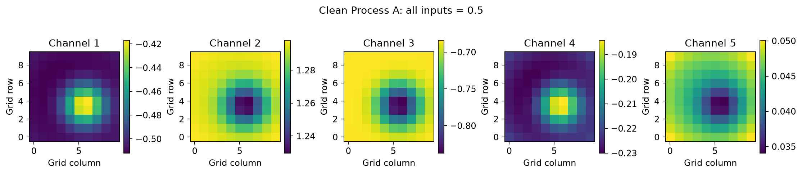

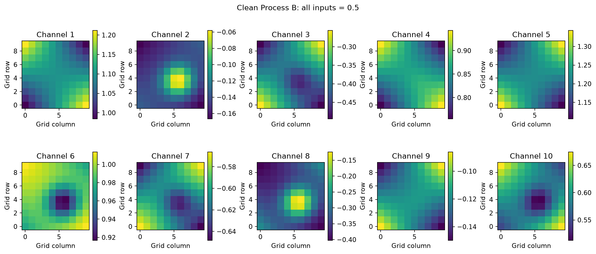

**What it shows:** the clean output maps of Process A (5 channels) and Process B (10 channels) when every input is 0.5. Each channel is a 10 × 10 map made of a few smooth spatial patterns. Because the channels share the same patterns, they move together, and a few PCA scores can describe them.

### Experiment 1 — which surrogate predicts maps best?

Mean RMSE ± SD across five seeds, against clean test maps:

| Process | Training settings | PCA+GP | PCA+RF | PCA+MLP | Direct GP | Direct RF | Direct MLP |
| --- | --- | --- | --- | --- | --- | --- | --- |
| A | 20 | **0.03583** ± 0.00278 | 0.19100 ± 0.02022 | 0.07644 ± 0.01710 | 0.07269 ± 0.00892 | 0.19238 ± 0.01887 | 0.09735 ± 0.02775 |
| A | 40 | **0.02034** ± 0.00252 | 0.14016 ± 0.02679 | 0.03447 ± 0.00486 | 0.05288 ± 0.00329 | 0.14106 ± 0.02652 | 0.04515 ± 0.00533 |
| A | 80 | **0.01200** ± 0.00124 | 0.09137 ± 0.01389 | 0.02517 ± 0.00758 | 0.05037 ± 0.00499 | 0.09223 ± 0.01329 | 0.02532 ± 0.00287 |
| A | 160 | **0.00785** ± 0.00054 | 0.07113 ± 0.01273 | 0.02233 ± 0.00366 | 0.03283 ± 0.00342 | 0.07261 ± 0.01287 | 0.01899 ± 0.00177 |
| B | 20 | **0.07763** ± 0.02463 | 0.21344 ± 0.01300 | 0.11228 ± 0.02761 | 0.11960 ± 0.01740 | 0.21339 ± 0.01244 | 0.18981 ± 0.04508 |
| B | 40 | **0.03868** ± 0.00135 | 0.18687 ± 0.01456 | 0.06562 ± 0.02577 | 0.08108 ± 0.00736 | 0.18645 ± 0.01440 | 0.10394 ± 0.02493 |
| B | 80 | **0.01652** ± 0.00581 | 0.14987 ± 0.02850 | 0.03730 ± 0.00712 | 0.04550 ± 0.00693 | 0.14989 ± 0.02906 | 0.04958 ± 0.00762 |
| B | 160 | **0.00912** ± 0.00140 | 0.09579 ± 0.00690 | 0.02615 ± 0.00451 | 0.03192 ± 0.00302 | 0.09653 ± 0.00650 | 0.02539 ± 0.00436 |

For reference, predicting the training-average map for every test setting gives an error of 0.30–0.41.

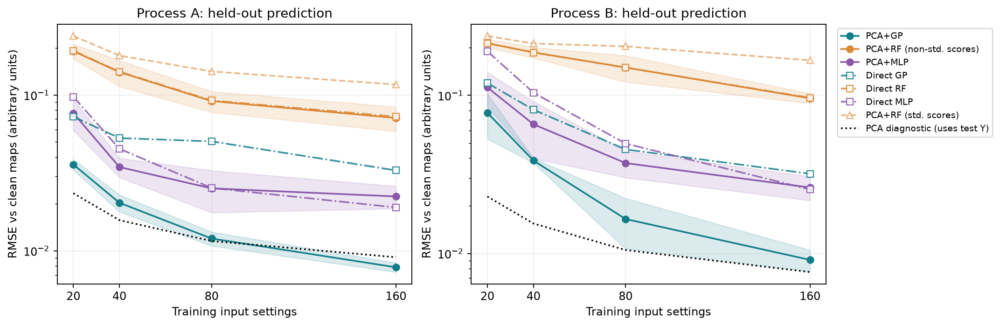

**What it shows:** test error (log scale) against the number of training settings, for every model and both processes.

- **Line styles:** solid lines are PCA models, dash-dot lines are direct models, and the faint dashed line is PCA+RF with standardised scores.
- **The dotted line is the PCA limit:** the error left if the five scores of each test map were predicted perfectly.
- **What to look for:** PCA+GP drops fastest and stays lowest.

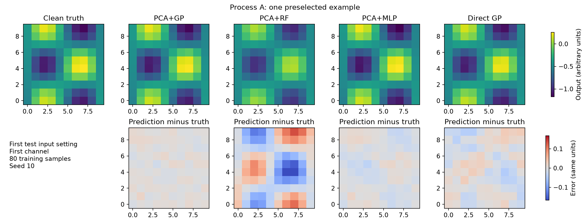

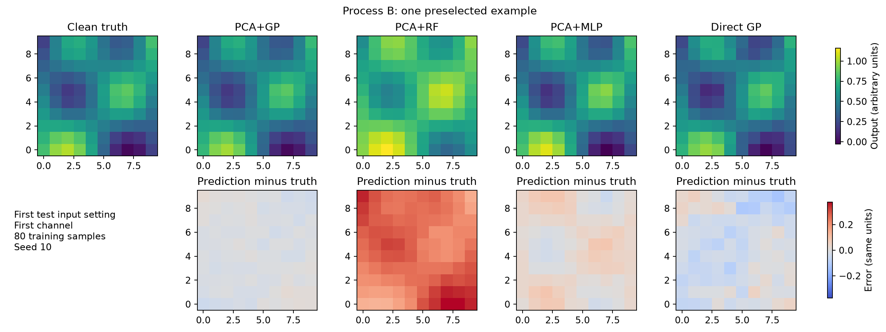

**What it shows:** one test setting (first channel, 80 training settings, seed 10).

- **Top row:** the clean truth and four models' predicted maps.
- **Bottom row:** prediction minus truth.
- **What to look for:** PCA+GP's error map is almost blank. PCA+RF is the clear outlier: it misses whole blobs of the pattern for A (strong red and blue patches) and is too high across the whole map for B.

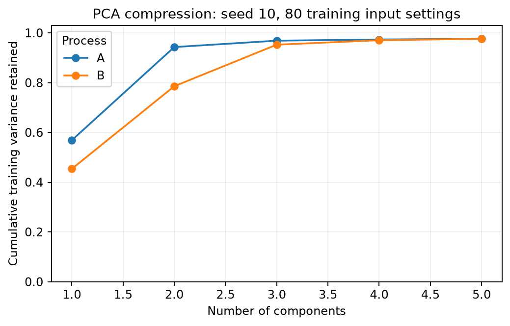

**What it shows:** the share of the training maps' variation kept by the first 1–5 PCA scores (80 training settings, seed 10).

- Two scores keep most of Process A's variation; B needs three.
- Five scores keep 97–98% for both processes, at every training size.
- So compressing 500 or 1,000 values to 5 numbers loses little.

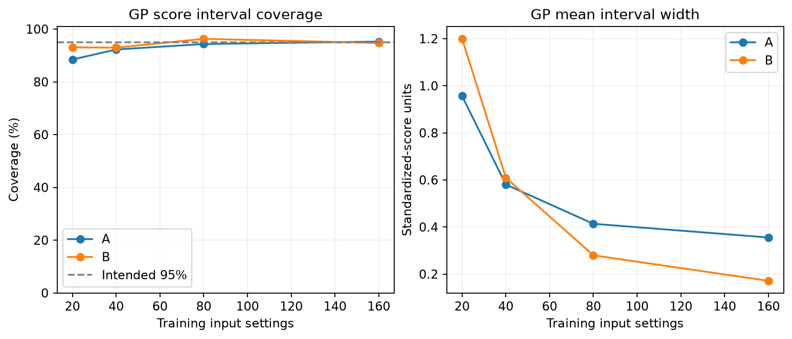

**What it shows:** how often the GP's 95% ranges for the scores contain the observed score (left), and how wide those ranges are (right).

- **Coverage:** close to the intended 95% from about 80 training settings.
- **Width:** the ranges narrow as data grows.

**Findings**

- **PCA+GP is the most accurate model at every size for both processes.** Going from 20 to 160 training settings cuts its error by 78% (A) and 88% (B).
- **PCA helps the GP a lot.** PCA+GP beats Direct GP in all 40 paired runs, with 35–76% lower error, and it is roughly 10–20× faster at 160 settings. Each score gets its own GP settings, while Direct GP has to use one setting for hundreds of outputs that behave differently.
- **PCA helps the MLP when data is scarce.** PCA+MLP wins every run at 20 and 40 settings; at 160 the two are about level.
- **PCA makes almost no difference to the Random Forest** (within about 2%). This holds only when RF learns the scores at their natural size: standardising them raises RF error by 11–74%, and the unscaled version wins 38 of 40 paired runs.
- **Why standardising the scores after PCA hurts the Random Forest:**
  - **How a tree picks a split.** It chooses the cut that most reduces the squared error of its targets, added up across all targets.
  - **With raw scores, the weights match what the RMSE measures.** Score 1 varies much more than score 5, so it dominates the split choice. That is the right priority, because score 1 also has by far the biggest effect on map error.
  - **After standardising, every score has SD 1 and counts equally.** Score 5 is a small pattern and mostly noise, yet it now gets as much say over the splits as score 1. The trees spend many splits on patterns that barely affect the map, and the large patterns are fitted worse.
  - **The damage grows with more data:** +25% → +64% from 20 to 160 settings for A, and +11% → +74% for B.
- **Why raw-score PCA+RF ≈ Direct RF.** PCA is only a rotation of the output space, and a rotation does not change the total squared error, so a tree's split criterion is the same either way. Direct RF is in effect "PCA+RF with raw scores and all components kept". Keeping only 5 components also drops some noise, which is why the raw-score version is slightly better on Process A (0.6–2.0% lower error at every size).
- **Compression is not the bottleneck.** Five scores keep 97–98% of the variation, and the PCA limit (0.008–0.023) is well below most models' errors.
- **The GP's uncertainty becomes trustworthy with enough data.** Its 95% ranges contain the observed score 88.5% (A) and 93.1% (B) of the time at 20 settings, and 95.3% and 94.7% at 160.

### Experiment 2 — can the surrogate find better input settings?

The goal is to find the input setting whose map best matches a target map. Each search starts from 20 evaluated settings and picks 24 more from 1,500 candidates. Three ways of choosing the next setting are compared:

- **PCA+GP BO:** Bayesian optimisation that predicts whole maps.
- **Scalar GP BO:** standard Bayesian optimisation that predicts only the final match error.
- **Random search.**

Clean match error (MSE) of the recommended setting after all 44 evaluations, mean ± SD over five seeds:

| Process | PCA+GP BO | Scalar GP BO | Random search |
| --- | --- | --- | --- |
| A | 0.000616 ± 0.0000009 | 0.000616 ± 0.0000009 | 0.006401 ± 0.005026 |
| B | 0.002047 ± 0.000000 | 0.002234 ± 0.000418 | 0.009616 ± 0.002685 |

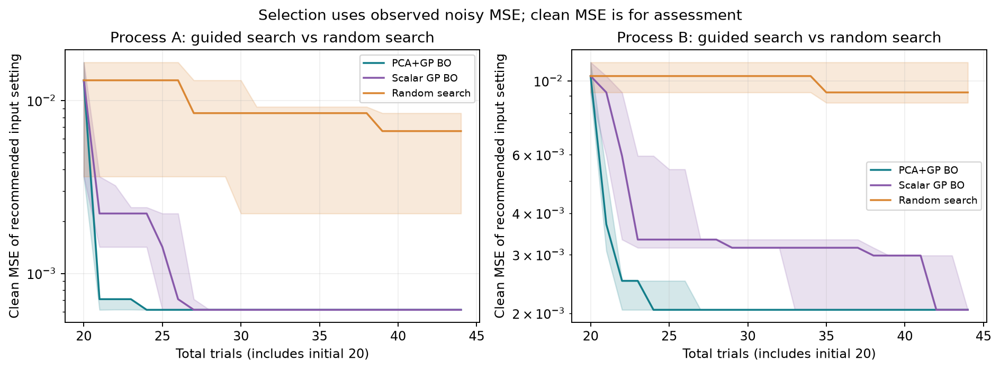

**What it shows:** the clean match error of the setting each method would recommend so far (log scale), against the number of evaluations, starting with the 20 initial ones.

- **Lines and bands:** each line is the median over five seeds; the band spans the middle 50%.
- **What to look for:** PCA+GP BO drops to its final value within a few steps.

**Findings**

- **Both GP methods beat random search in every run,** ending with 4–10× lower error.
- **Both end up at almost the same recipe.** PCA+GP BO found the best candidate of all 1,500 in 9 of 10 runs, Scalar GP BO in 8 of 10. Head to head: PCA+GP BO better in 2 runs, Scalar GP BO in 1, and 7 ties.
- **PCA+GP BO gets there much faster.** Its median result stops improving within the first **4** search steps on both processes; Scalar GP BO needs about **8** steps (A) and **22** (B). Each evaluation gives it five scores describing the whole map instead of one number.

### Experiment 3 — can one model serve two processes?

Each query is encoded as (input setting, map location, output ID) and the model returns one value. One network trained on A and B together is compared with a separate network per process. Training sees only a 5 × 5 grid of locations; testing covers all 100.

| Process | Separate models | Shared model | Change |
| --- | --- | --- | --- |
| A | 0.14225 ± 0.00674 | 0.13662 ± 0.00698 | −4.0% |
| B | 0.11187 ± 0.02216 | 0.10663 ± 0.00901 | −4.7% |

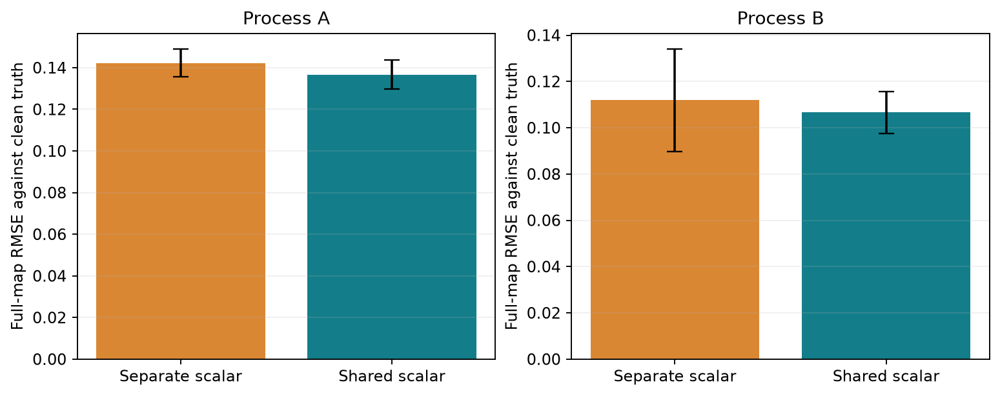

**What it shows:** mean test error of the separate and shared models for each process. Error bars are one SD over three splits. The shared bar is slightly lower for both processes, but the error bars overlap, and for B the separate model varies much more between splits.

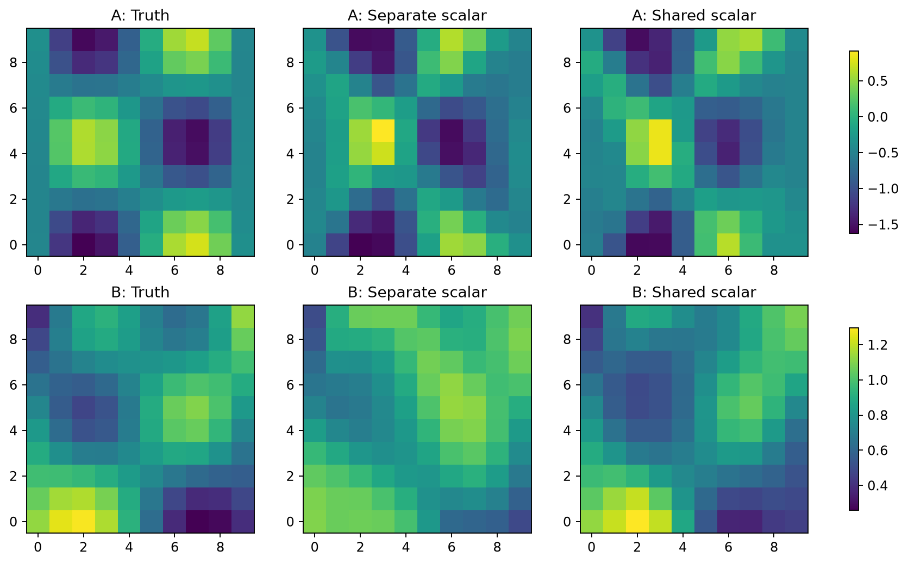

**What it shows:** the true map (left) and the two models' predictions for the first test setting of each process (first channel, seed 101).

- Both models recover the main pattern from the 5 × 5 training locations.
- For A the two predictions look similar. For B the shared model's map is visibly closer to the truth, especially the bright lower-left corner.

**Finding:** sharing lowers error slightly. It wins 3 of 3 splits for A and 2 of 3 for B, so the evidence is limited.

---

## 2. BOSCH plasma etching (real wafers)

**Data.** [Zenodo record 17122442](https://doi.org/10.5281/zenodo.17122442) (CC BY 4.0; details in [data/bosch/SOURCE.md](data/bosch/SOURCE.md)).

- **Wafers:** 88, in 10 lots, all etched with one deep-silicon recipe: 100 cycles of an SF6 etch step and a C4F8 protective step.
- **Before each lot,** the chamber was conditioned 1, 3 or 9 times, on the empty chuck, a Si wafer or an SiO₂ wafer. That is one label per lot, such as "3C - Si".
- **Outputs per wafer:** 89 points × 2 channels: **oxide etch** (mask loss, about 0.67 µm) and **Si etch** (depth, about 43.7 µm). That makes 178 values.
- **Inputs (6):**
  - position of the wafer in its lot;
  - number of conditioning repeats;
  - conditioning surface (three yes/no columns);
  - incoming oxide thickness.

  Four of the six are the same for every wafer in a lot.

**Test: leave one lot out.**

- Train on 9 lots, predict every wafer of the 10th, and repeat for all 10 lots, so each wafer is predicted once.
- Training sizes are 20, 40 and 78 wafers; 78 is the smallest number available when a 10-wafer lot is held out.
- Each experiment uses 5 seeds.
- Errors are against the **measured** maps.
- **Normalised RMSE** divides each channel's error by that channel's overall spread (SD), so **1.0 ≈ always guessing the average** and 0 = perfect.

### Experiment 1 with the 6 inputs

Normalised RMSE, mean over five seeds:

| Training wafers | PCA+shared GP | PCA+RF | PCA+MLP | Direct GP | Direct RF | Direct MLP | PCA+RF (std.) |
| --- | --- | --- | --- | --- | --- | --- | --- |
| 20 | 0.721 | 0.654 | 0.820 | 0.702 | 0.657 | 0.946 | **0.650** |
| 40 | 0.722 | 0.649 | 0.846 | 0.650 | 0.652 | 1.009 | **0.639** |
| 78 | 0.731 | 0.668 | 0.954 | **0.660** | 0.676 | 1.007 | 0.669 |

At 78 wafers, the best oxide error is 0.072 µm (Direct GP) and the best Si error is 0.373 µm (PCA+RF std.).

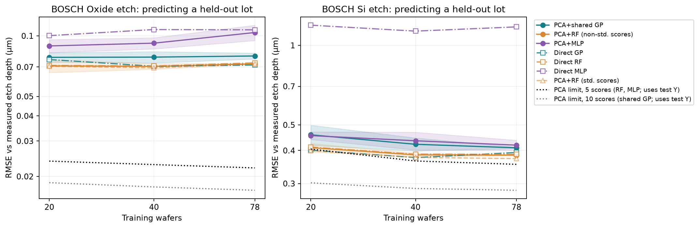

**What it shows:** error on the held-out lot (µm, log scale) against training wafers, for oxide (left) and Si (right).

- **Line styles:** as in the synthetic figure.
- **Dotted lines:** the PCA limits. Black is for 5 scores (used by PCA+RF and PCA+MLP); grey is for 10 scores (used by PCA+shared GP).
- **What to look for:** the lines are nearly flat, so more wafers barely help. For oxide, every model sits far above both PCA limits; for Si, the best models are close to the 5-score limit.

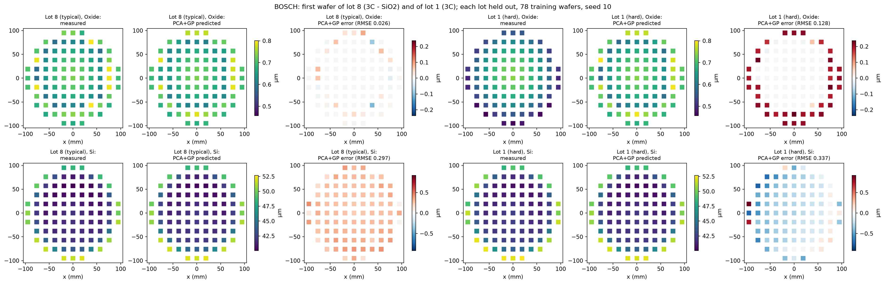

**What it shows:** measured map, PCA+shared GP prediction and error on the wafer plane, for the first wafer of lot 8 (typical) and of lot 1 (hard). Each was predicted with its lot held out (78 training wafers, seed 10).

- **Lot 8:** oxide is predicted well (RMSE 0.024 µm), and Si is about 0.26 µm too high across the whole wafer.
- **Lot 1:** the model expects the usual oxide edge and overpredicts the edge ring (oxide RMSE 0.128 µm). This lot etched much less oxide at the edge.

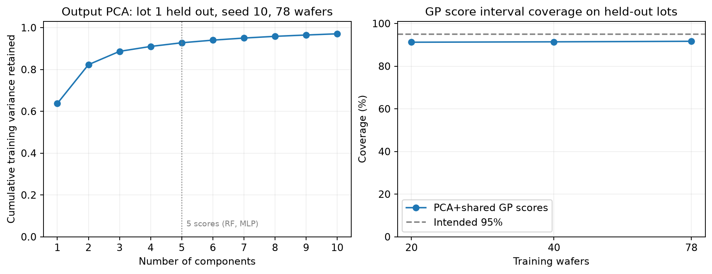

**What it shows:**

- **Left:** the share of map variation kept by the first 1–10 PCA scores for one fold (lot 1 held out): about 93% with 5 scores and 97% with 10. Over all folds the ranges are 94–96% (5 scores) and 97.7–99.5% (10 scores).
- **Right:** how often PCA+shared GP's 95% ranges contain the held-out lots' scores: 91–92%, a little below the intended 95%.

**Findings**

- **With only the 6 inputs, PCA+shared GP is not the best model.** It has 3–11% higher error than Direct GP and is better in only 1 of 15 seed comparisons (1/5 at 20 wafers, 0/5 at 40 and 78). The 6 inputs carry too little information for the PCA step to help the GP.
- **More training wafers barely help.** Going from 20 to 78 wafers changes the error little for every model. The difficulty is that each new lot behaves differently, not a shortage of wafers.
- **The effect of PCA depends on the model:**
  - Random Forest: PCA+RF beats Direct RF in all 5 seeds, but by less than 1.2%.
  - MLP: PCA cuts the error by 5–16%.
  - GP: PCA+shared GP is 3–11% worse than Direct GP (see above).
- **Si is fairly predictable; oxide is not.**
  - **Si:** errors of 0.37–0.46 µm (all models except Direct MLP) sit close to the 5-score PCA limit of 0.355 µm, the error left even if the scores were predicted perfectly (0.283 µm with 10 scores). Later wafers in a lot etch less, and the models learn this from position.
  - **Oxide:** the best error, 0.072 µm, is about three times the 5-score PCA limit of 0.022 µm (0.017 µm with 10 scores). Some lots, mainly lots 1 and 2, etch much less oxide at the wafer edge, and none of the 6 inputs explains why.
- **PCA compression is not the main problem.** Five scores keep 94–96% of the map variation, and ten keep 97.7–99.5%.
- **The GP is slightly overconfident on new lots.** PCA+shared GP's 95% ranges contain the true score 91–92% of the time.
- **A new lot is much harder than a known one.** If test wafers are drawn at random from all lots, errors fall to 0.30–0.40 (against 0.66–1.01 by lot): new lots are 67–210% harder.
- **A shared conditioning label can mislead.** For the GP and Random Forest models, lots whose label also appears in another lot are *harder* (0.79–0.93 at 78 wafers) than lots with a unique label (0.51–0.54). Lots 1 and 9 are both "3C" but etched very different amounts of oxide.

### Extra inputs: machine readings and plasma light

The machine also records what happens *during* each etch. Two summaries of these recordings were added as inputs:

- **53 machine readings:** gas flows, pressures, powers and temperatures, each averaged over the etch steps and over the protective steps.
- **5 emission-line features from the plasma light:** the brightness of fluorine at 686 and 704 nm (in both step types) and of the C₂ carbon band at 516 nm (protective steps).
  - The spectrometer's wavelength scale was corrected by 1.21 nm before measuring them.
  - Seven other lines that were looked for (Si, SiF, CO, He, H, Ar, O) are not visible in the spectra.

Both summaries are recorded while the wafer is etched. A model that uses them therefore predicts a wafer's map after etching but before it is measured, not before the wafer is run.

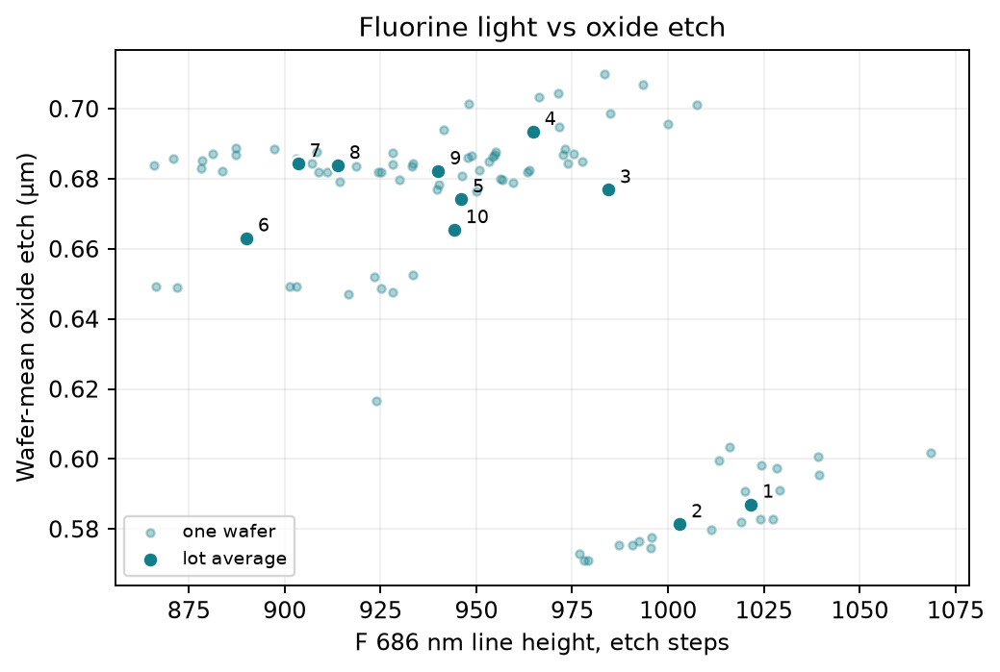

**What it shows:** the fluorine 686 nm line height during the etch steps against the wafer's mean oxide etch. Small dots are wafers; large dots are lot averages, numbered by lot. Lots 1 and 2, the two low-oxide lots (about 0.58 µm), have the brightest fluorine light, while the other lots sit around 0.66–0.69 µm.

The same seven models are compared. Before standardising, inputs are clipped to their training range in all three sets, which is why the 6-input numbers here differ slightly from the table above.

Normalised RMSE at 78 training wafers, mean over five seeds:

| Model | 6 inputs | + 53 machine readings | + 5 emission lines |
| --- | --- | --- | --- |
| **PCA+shared GP** | 0.743 | 0.707 | **0.486** |
| PCA+RF | 0.668 | 0.791 | 0.645 |
| PCA+MLP | 0.954 | 0.676 | 0.699 |
| Direct GP | 0.660 | 0.595 | 0.542 |
| Direct RF | 0.676 | 0.788 | 0.644 |
| Direct MLP | 1.012 | 0.743 | 0.746 |
| PCA+RF (std.) | 0.669 | 0.773 | 0.633 |

The same comparison per channel, at 78 training wafers:

| | 6 inputs (best model) | + 53 machine readings (best) | + 5 emission lines (best) |
| --- | --- | --- | --- |
| Oxide etch (µm) | 0.072 (Direct GP) | 0.065 (Direct GP) | **0.053** (PCA+shared GP) |
| Si etch (µm) | 0.373 (PCA+RF std.) | **0.298** (Direct GP) | 0.346 (Direct GP) |

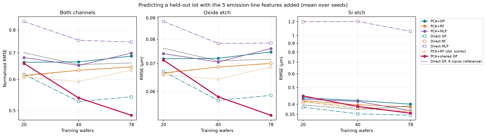

**What it shows:** error on the held-out lot against training wafers for all seven models with the 5 emission lines added, for both channels together, oxide and Si.

- **The black dotted line** is Direct GP with only the 6 inputs, for reference.
- **What to look for:** PCA+shared GP (thick line) keeps improving with more wafers and ends lowest.

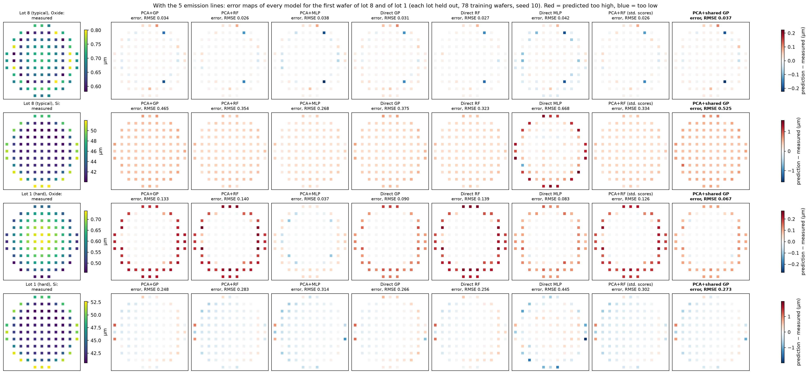

**What it shows:** the same two wafers as the main-run example maps, now for all seven models with the emission lines (78 training wafers, seed 10).

- **First column:** the measured map. **Other columns:** prediction minus measurement (red = too high, blue = too low).
- **Lot 1 oxide:** most models still overpredict the edge ring, but PCA+shared GP's ring is faint (RMSE 0.067 µm against 0.126–0.140 for the Random Forests).
- **Lot 8 Si:** most models are uniformly a little too high.
- **Single wafers vary:** these are two wafers only, and the ranking of models changes from wafer to wafer.

**Findings**

- **The plasma light is the first input that explains oxide.** With the 5 emission lines, Direct GP improves by 18% (0.660 → 0.542, better in 5 of 5 seeds) and its oxide error falls from 0.072 to 0.059 µm.
- **Why it works:** the fluorine line is brightest in lots 1 and 2, the two low-oxide lots, at 1,022 and 1,003 counts against 890–985 for the others. The light measures the chamber's actual state, which the conditioning label only approximates. It also tells lot 1 from lot 9 despite their identical label.
- **With the emission lines, PCA+shared GP is the best model.** It reaches **0.486**, the lowest error of any model and input set, with an oxide error of 0.053 µm. It also gains the most from the emission lines: 35% lower error than with the 6 inputs (5 of 5 seeds). Against Direct GP it is 10% better at 78 wafers (5 of 5 seeds), but about level at 40 (3 of 5) and worse at 20 (1 of 5).
- **The largest gains are on the hardest lots.** For PCA+shared GP, adding the emission lines lowers lot 1's oxide error from 0.136 µm to 0.056 µm, and lot 9's from 0.126 to 0.074.
- **The 53 machine readings mainly help Si,** giving the lowest Si error (0.298 µm, Direct GP). They hurt the Random Forests, which cannot ignore unhelpful inputs: they get 15–18% worse.
- **Cautions:**
  - **Weak seed evidence at 78 wafers.** The five seeds use almost the same wafers there: for 6 of the 10 lots the training pool is exactly 78 wafers, so those folds are identical in every seed. Agreement across seeds at that size is weak evidence.
  - **Settings chosen on the same lots.** The PCA+shared GP settings (10 scores, large scores weighted more) were chosen after trying six versions on these same lots.
  - **Only 10 lots.** The fluorine signal mainly separates 2 low-oxide lots from 8 others.
  - **Within-lot jumps.** Sudden oxide changes between wafers *within* a lot remain unexplained.

---

