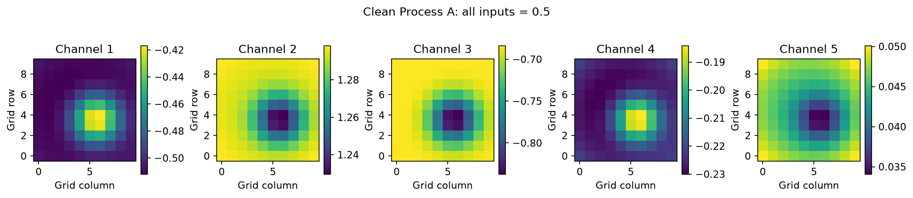
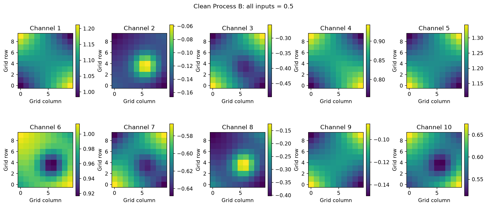
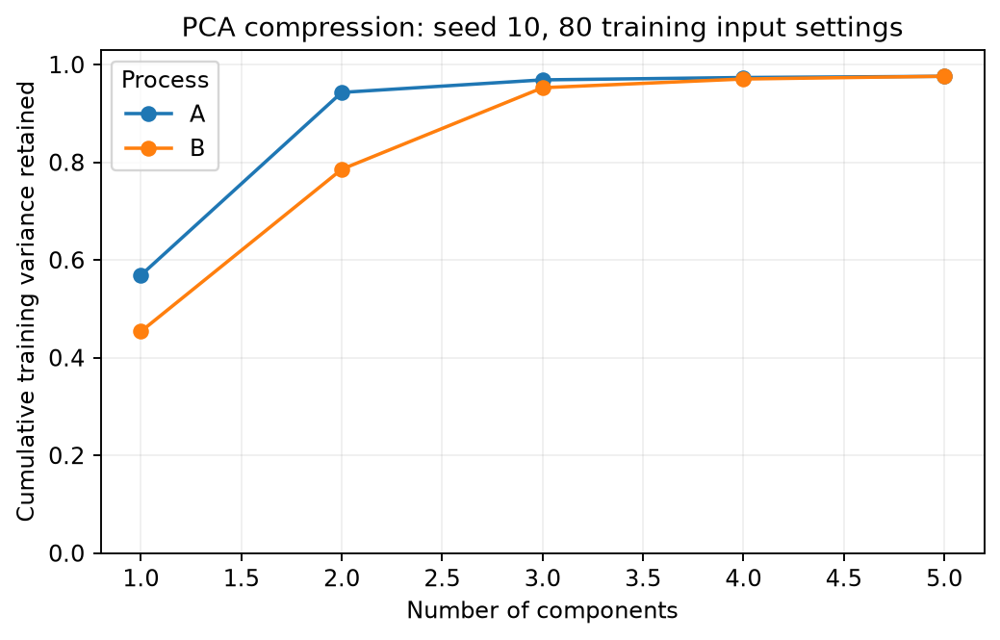
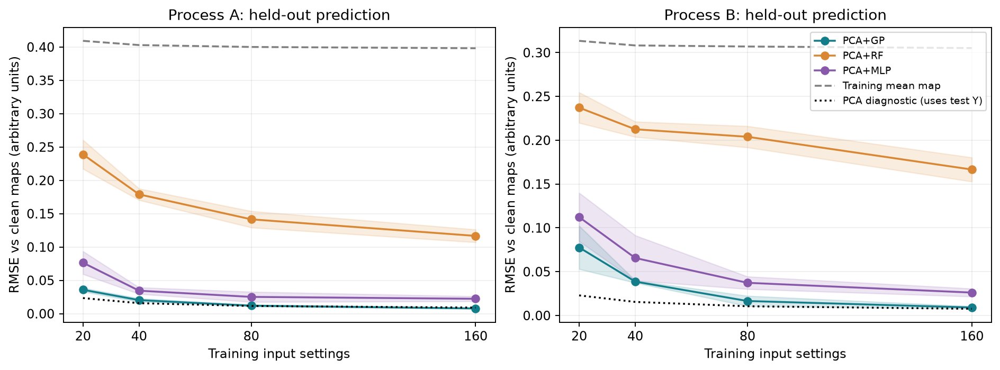
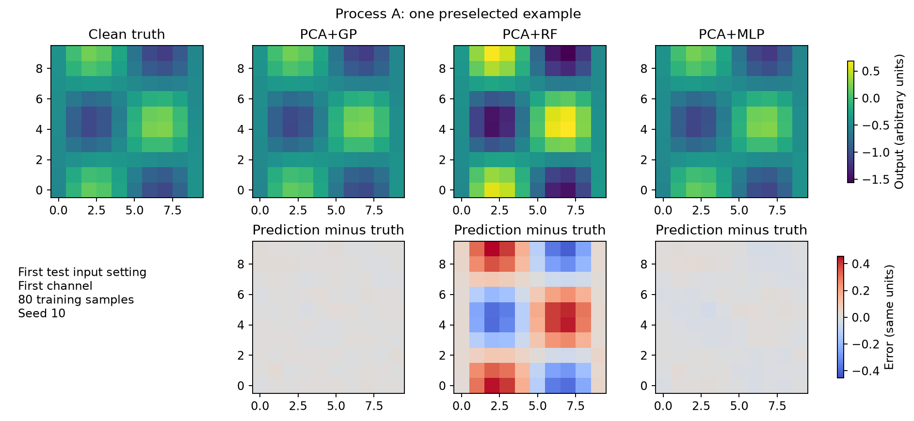
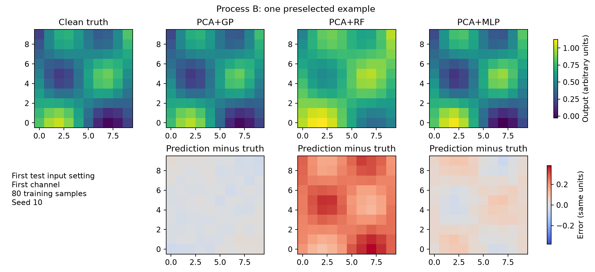
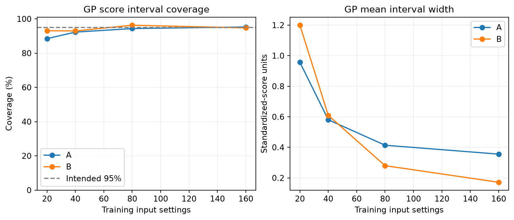
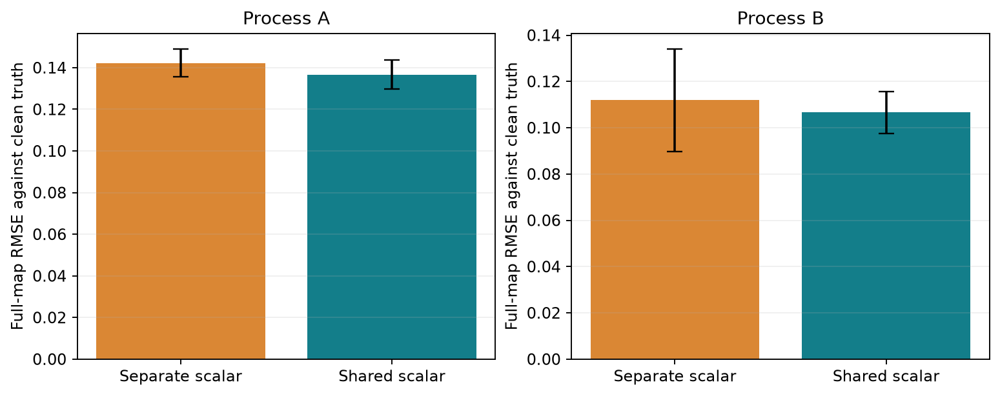
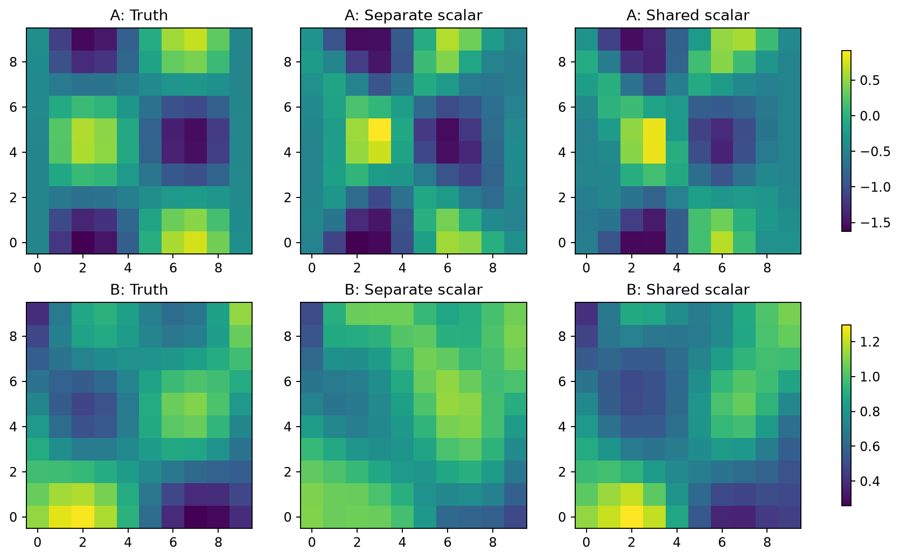

# PCA-Based Surrogate Modeling and Bayesian Optimization of Synthetic Processes

Idea: **We choose some input settings, and a process produces output values.** We want to learn that relationship, use it to choose better inputs, and see whether one model can serve two processes.

This guide starts from that idea and builds up the experiments one at a time. The [notebook](Process_Study_Code_Only.ipynb) contains the code and its executed outputs. This README explains what those calculations mean.

> **Two kinds of numbers appear below.** “Teaching example” means small invented numbers used to explain a calculation. “Measured result” means a value from the executed study. They are never mixed in the result tables.

The route through the study is:

**Look at the data → learn to predict maps → check uncertainty → choose better input settings with BO → try sharing a model.**

Process **A** and Process **B** are two datasets. Experiment **1**, **2**, and **3** are three questions we ask about them. These are different kinds of labels.


## 1. Follow one input setting through the synthetic process

### Start with three input values

For Process A, consider this input setting:

`x1 = 0.2, x2 = 0.6, x3 = 0.8`

An **input setting** is one combination of input values.

Here we consider the process to be multi channel, each with a respective map (grid of values: the row and column format). A **channel** is one type of output with its own map. For example, channel 1 and channel 3 are two different outputs at the same location. Their numerical values need not be similar.


| Process | Inputs in one input setting | Maps produced | Size of each map | Numbers produced per input setting |
| --- | --- | --- | --- | --- |
| A | 3 | 5 channels | 10 × 10 | 500 |
| B | 4 | 10 channels | 10 × 10 | 1,000 |


Five hundred outputs do **not** mean five hundred independent experiments. We chose one input setting, so we have one example with a large output.

### Where the outputs come from

As data source for this synthetic study, we use a pre-designed function to creates the maps. We create each output map by **adding together five simple patterns**. Imagine stacking five transparent sheets, each with a different picture.

| Pattern | What it looks like |
| --- | --- |
| Flat level | The same value everywhere |
| Bowl | Values change from the centre toward the edges |
| Wave | Alternating high and low bands |
| Bump | One small area with higher values |
| Diagonal pattern | Values change along a diagonal |

The **input setting** is simply the list of input numbers, such as `[0.2, 0.6, 0.8]`. The synthetic function converts those numbers into amounts of each pattern.

```text
Output map = starting level
           + 0.4 × flat pattern
           + 0.2 × bowl pattern
           − 0.3 × wave pattern
           + 0.8 × bump pattern
           + 0.1 × diagonal pattern
```

Actual synthetic generator used :
$$
Y_{r,s,k}(X) = b_k + \sum_{j=1}^{5} c_j(X)\,W_{j,k}\,B_j(r,s)
$$

**Where:**

- $X$: Input recipe (3 variables for Process A, 4 for Process B).
- $Y_{r,s,k}(X)$: Generated output at grid location $(r,s)$ for channel $k$.
- $b_k$: Fixed starting level (offset) for output channel $k$.
- $c_j(X)$: Recipe-dependent coefficient for spatial pattern $j$.
- $W_{j,k}$: Fixed weight connecting spatial pattern $j$ to output channel $k$.
- $B_j(r,s)$: Value of spatial pattern $j$ at grid location $(r,s)$.
- $j$: Spatial pattern index ($1$ to $5$).
- $k$: Output channel index ($1$ to $5$ for Process A, $1$ to $10$ for Process B).
- $(r,s)$: Row and column coordinates of the $10 \times 10$ spatial grid.

At **every location in the map**, we multiply that location’s value in each pattern by its amount, then add the five contributions and the starting level. That gives the output value at that location. A different input setting changes these amounts, so the resulting map changes.

**Each channel is a different output measurement.** For the same input setting, channel A1 might show a strong bump, while channel A2 shows a stronger wave. Each channel has fixed weights controlling how the input setting changes its pattern amounts, and a starting level that shifts the values of its map up or down. We built the synthetic function this way so the maps have a simple underlying structure. That gives PCA recurring structure to discover when it compresses the outputs later.

### Calculate one value in channel A3

At one location in one channel, the calculation is:

`output = contribution 1 + contribution 2 + contribution 3 + contribution 4 + contribution 5 + offset`

**Calculated from the actual generator:** for our input setting `[0.2, 0.6, 0.8]`, channel A-3 at row 6, column 7 has these contributions. Rows and columns are counted from zero.


| Term | Contribution, rounded |
| --- | --- |
| Flat pattern | −0.630132 |
| Bowl pattern | +0.000937 |
| Wave pattern | +0.163366 |
| Bump pattern | −0.023188 |
| Diagonal pattern | +0.009956 |
| Channel offset | +0.388890 |
| Total output | −0.090171 |


The total **−0.090171 is the true synthetic value at one specific location in channel A3**, for the input setting `[0.2, 0.6, 0.8]`. The table shows how our synthetic function calculates that one value.  Channel A3 has a **10 × 10 map**, so it contains **100 values**. This table calculates just one of those 100 values: row 6, column 7, using zero-based indices.

The generator’s weights stay fixed throughout the study. Changing input settings or random sampling seeds does not redefine the underlying process.

### Look at whole maps

The next pictures use a different, simple reference input setting: every input is set to 0.5. They show all output channels before adding noise or fitting a model.




**Read this picture:** Each panel is one of A’s five channels. A color gives the value at that location. Bright does not automatically mean good; we have not defined an optimization objective yet.




**Read this picture:** B produces ten channels. Each panel has its own color scale, so equal colors across channels can represent different numbers.


### Add imperfect observations

For the prediction experiment, we add independent normal noise with standard deviation **0.035** to the clean map values. A model trains on these noisy observations. Because we generated the data ourselves, we can still compare its predictions with the hidden clean answer.

**Conclusion:** “One input setting goes into a fixed synthetic function and produces several maps. The dataset contains input setting/map pairs. The models learn from noisy versions of those pairs.”


## 2. Training & Inference Insights

### Why compress the output?

Process A has 500 output numbers per input setting. Many of these values move together because the maps have repeated spatial structure. PCA looks for a small number of patterns that describe most of that variation. Instead of predicting all 500 numbers directly, we ask the model to predict five numbers. These are called **PCA scores**. A stored PCA decoder then expands the five numbers into the full maps.


### How PCA Compresses and Reconstructs Output Maps ?

Imagine each output map contains only **two values**. We observe three maps from three different input settings.

| Training example | Original map |
|---|---|
| 1 | [1, 3] |
| 2 | [2, 4] |
| 3 | [3, 5] |

Notice that the second value is always 2 greater than the first. Both values increase together, meaning their variation is redundant. Instead of storing two changing values, PCA can represent each map using **one number (PCA score)**.

#### Step 1 — Calculate the Mean Map

Calculate the average of each position across all three maps.

$$
\mu = \left[\frac{1+2+3}{3},\frac{3+4+5}{3}\right]
$$

$$
\boxed{\mu=[2,4]}
$$

Subtract the mean from each original map.

| Original map | Difference from mean |
|---|---|
| [1, 3] | [−1, −1] |
| [2, 4] | [0, 0] |
| [3, 5] | [1, 1] |


#### Step 2 — Find the Principal Component Direction

PCA identifies the direction along which the centered data varies the most. Here, both values increase together, so the direction is:

$$
[1,1]
$$

However, PCA requires a **unit direction**, meaning its length must equal 1.

Calculate the length:

$$
\|[1,1]\|=\sqrt{1^2+1^2}=\sqrt{2}=1.4142
$$

Normalize the direction:

$$
v_1=\frac{[1,1]}{\sqrt{2}}
$$

$$
\boxed{v_1=[0.7071,0.7071]}
$$

This is the first principal component direction.

#### Step 3 — Compress Each Map into One PCA Score

To calculate a PCA score, take the **dot product** between the centered map and the principal direction.

$$
z=(Y-\mu)\cdot v_1
$$

For the first map, `[1, 3]`:

**1. Subtract the mean:**

$$
[1,3]-[2,4]=[-1,-1]
$$

**2. Calculate the dot product:**

$$
z=(-1)(0.7071)+(-1)(0.7071)
$$

$$
\boxed{z=-1.4142}
$$

Similarly, for the third map, `[3, 5]`:

$$
z=(1)(0.7071)+(1)(0.7071)
$$

$$
\boxed{z=1.4142}
$$

The resulting PCA scores are:

| Original map | Difference from mean | PCA score |
|---|---|---|
| [1, 3] | [−1, −1] | −1.4142 |
| [2, 4] | [0, 0] | 0 |
| [3, 5] | [1, 1] | +1.4142 |

**Result:** Each map has been compressed from **2 values into 1 PCA score**.

#### Step 4 — Reconstruct the Original Map

PCA reconstructs a map using:

$$
\boxed{\text{Map}=\text{Mean Map}+\text{Score}\times\text{Direction}}
$$

Consider the first map, whose PCA score is `−1.4142`.

Substitute the values:

$$
Y=[2,4]+(-1.4142)[0.7071,0.7071]
$$

Multiply the score by the direction:

$$
(-1.4142)[0.7071,0.7071]\approx[-1,-1]
$$

Add the mean map:

$$
Y=[2,4]+[-1,-1]
$$

$$
\boxed{Y=[1,3]}
$$

We successfully reconstructed the original map using just **one PCA score**.

Similarly, for the third map:

$$
Y=[2,4]+(1.4142)[0.7071,0.7071]
$$

$$
Y=[2,4]+[1,1]
$$

$$
\boxed{Y=[3,5]}
$$

In this example, reconstruction is exact (apart from rounding) because all three maps vary along the same direction.

#### Step 5 — Predict a New Map Using a PCA Score

Now suppose a trained model predicts a PCA score of `0.7071` for a new input setting.

We can reconstruct the corresponding map without directly predicting its two output values.

$$
Y=[2,4]+0.7071[0.7071,0.7071]
$$

$$
Y\approx[2,4]+[0.5,0.5]
$$

$$
\boxed{Y\approx[2.5,4.5]}
$$

The predicted score is hypothetical and is used only to demonstrate reconstruction.

**In the actual project**, Gaussian Process models predict PCA scores from input recipes. The PCA inverse transformation then reconstructs the spatial output maps.

---

### What if the PCA Direction Were [1, 2] ?

Consider the same three training maps, but suppose we try a different direction:

$$
[1,2]
$$

This is an illustrative alternative direction, **not the direction PCA would select for these three maps**.

#### Step 1 — Normalize the Direction

Calculate its length:

$$
\sqrt{1^2+2^2}=\sqrt5=2.2361
$$

Divide each component by the length:

$$
v=\frac{[1,2]}{\sqrt5}
$$

$$
\boxed{v=[0.4472,0.8944]}
$$

#### Step 2 — Calculate the PCA-like Projection Score

Take the original map `[3, 5]`.

Subtract the mean:

$$
[3,5]-[2,4]=[1,1]
$$

Project this centered map onto the new unit direction:

$$
z=[1,1]\cdot[0.4472,0.8944]
$$

$$
z=(1)(0.4472)+(1)(0.8944)
$$

$$
\boxed{z=1.3416}
$$

Notice that this score differs from the earlier score of `1.4142` because we are projecting onto a different direction.

#### Step 3 — Reconstruct Using the New Direction

Use the same reconstruction formula:

$$
\text{Map}=\text{Mean Map}+\text{Score}\times\text{Direction}
$$

Substitute:

$$
Y=[2,4]+1.3416[0.4472,0.8944]
$$

Multiply:

$$
1.3416[0.4472,0.8944]\approx[0.6,1.2]
$$

Add the mean:

$$
Y=[2,4]+[0.6,1.2]
$$

$$
\boxed{Y\approx[2.6,5.2]}
$$

#### Step 4 — Compare the Reconstruction

| | Map values |
|---|---|
| Original map | [3, 5] |
| Reconstructed using [1, 1] direction | [3, 5] |
| Reconstructed using [1, 2] direction | [2.6, 5.2] |

The new direction produces reconstruction error:

$$
[3,5]-[2.6,5.2]=[0.4,-0.2]
$$

Its squared reconstruction error is:

$$
0.4^2+(-0.2)^2=\boxed{0.20}
$$


---

### Connection to the Actual Gaussian Process Project

In Process A, each input recipe generates 5 spatial output maps, each containing 10 × 10 values.

Therefore:

$$
5\times10\times10=500\text{ output values}
$$

The PCA-based surrogate pipeline is:

```text
    Input
      ↓
Synthetic function
      ↓
500 output values per recipe
      ↓
PCA compression
      ↓
5 PCA scores per input
      ↓
Train 5 Gaussian Process models
      ↓
New input recipe
      ↓
Predict 5 PCA scores
      ↓
PCA reconstruction
      ↓
500 predicted output values
      ↓
Reshape into five 10 × 10 maps
```

The underlying idea is the same as the two-value example:

- **Compression:** Replace a high-dimensional output map with a small set of PCA scores.
- **Prediction:** Train Gaussian Process models to predict those scores from input recipes.
- **Reconstruction:** Combine the predicted scores with the learned PCA directions and mean to recover the output maps.

**Important:** PCA does not select 5 of the original 500 output values. It learns 5 directions that summarize the variation across the full output vectors. Because only 5 components are retained, reconstructed maps may have some approximation error.

### Why are there two things to learn ?

We want to predict 500 output numbers from three inputs. We split this into two jobs:

```text
Job 1 — PCA:
Find a shorter way to describe the 500 output numbers.

Job 2 — GP, Random Forest, or MLP:
Learn how the three input numbers determine that shorter description.
```


### Check how well PCA compresses the outputs

This is a check of **PCA’s representation**. It asks how much training-output variation is retained by the selected components.



**Read this picture:** Each curve uses seed 10 and 80 training input settings. Move right to keep more components. The height tells us how much of the training-output variation those components retain. A retained-variance percentage is not a prediction-accuracy percentage.

#### 4. Next, train a model to predict those scores

We pair each input setting with the five scores PCA calculated for its observed outputs:

| Model input | Model target |
| --- | --- |
| Input setting 1: three input values | Input setting 1’s five PCA scores |
| Input setting 2: three input values | Input setting 2’s five PCA scores |
| … | … |
| Input setting 20: three input values | Input setting 20’s five PCA scores |

The predictor learns:

```text
3 input values → 5 PCA scores
```

We try three choices for this predictor:

| Predictor | How it predicts the scores |
| --- | --- |
| GP | Uses relationships between input settings to predict each score, with an uncertainty estimate. Our implementation fits five separate GPs, one per score. |
| Random Forest | Combines the predictions of many decision trees to return five scores. |
| MLP | Learns weights in a neural network that returns five scores. |

All three choices receive the same training input settings and the same PCA representation for a given comparison.

#### 5. Inference ?

```text
New input setting: 3 inputs
         ↓
Trained GP, Random Forest, or MLP
         ↓
5 predicted PCA scores
         ↓
PCA reconstruction
         ↓
500 predicted output values
         ↓
Arrange into five 10 × 10 maps
```

PCA reconstruction uses the same idea as the tiny example:

```text
Reconstructed output in scaled units
    = learned average output
    + predicted score 1 × learned direction 1
    + predicted score 2 × learned direction 2
    + ...
    + predicted score 5 × learned direction 5
```

We also rescales the numbers so the methods can work with values of comparable size. During training, it learns input scaling, channel scaling, PCA, and score scaling using the training examples only.

For a new input setting, the exact order is:

1. Apply the saved input scaling to its three numbers.
2. Predict five scaled scores.
3. Reverse score scaling to get scores in the units PCA uses.
4. Reconstruct the 500 values with the saved PCA mean and directions.
5. Reverse channel scaling and arrange the values into five maps.

We reuse the learned settings. The new input setting’s true outputs are not used in these steps.

#### The same flow for GP, Random Forest, and MLP

Think of **PCA as a way to translate 500 map values into five scores**, and translate those scores back into maps. The predictor learns to estimate those five scores from an input setting.

```text
TRAINING — PROCESS A

20 Input Recipes                     20 Observed Output Maps
(3 variables each)                   (500 values per recipe)
      │                                       │
      │                                       ▼
      │                              Fit PCA on Output Maps
      │                                       │
      │                              500 Values → 5 Scores
      │                                       │
      │                              20 × 5 PCA Score Matrix
      │                                       │
      └───────────────────┬───────────────────┘
                          │
                          ▼
                Train 5 Gaussian Processes
                (3 Inputs → 5 PCA Scores)
                One GP per PCA Score
                          │
                          ▼
                   Trained GP Models


PREDICTION — PROCESS A

                  New Input Recipe
                    (3 Variables)
                          │
                          ▼
                 5 Trained GP Models
                          │
                          ▼
                 5 Predicted PCA Scores
                          │
                          ▼
                 Inverse PCA Transform
                          │
                          ▼
                500 Predicted Values
                          │
                          ▼
                Reshape into 5 Maps
                  (10 × 10 Each)
```

We save PCA, the predictor, and the scaling settings. At inference, the PCA steps stay the same for all three methods:

```text
New input setting → trained GP            → five predicted scores → saved PCA decoder → five maps
New input setting → trained Random Forest → five predicted scores → saved PCA decoder → five maps
New input setting → trained MLP           → five predicted scores → saved PCA decoder → five maps
```

The saved scaling steps are applied and reversed in each pipeline. The new input setting’s actual maps are not needed to produce a prediction.

| Predictor | What it learns |
| --- | --- |
| GP | Relationships between input settings, using five separate GPs—one for each score |
| Random Forest | Many decision trees whose predictions are averaged to produce five scores |
| MLP | Neural-network weights that turn three inputs into five scores |


#### 7. How this leads into Experiment 1

We now have three complete prediction pipelines:

```text
Input setting → GP            → PCA scores → output maps
Input setting → Random Forest → PCA scores → output maps
Input setting → MLP           → PCA scores → output maps
```

Experiment 1 asks: **Which pipeline predicts unseen input settings most accurately, and how does that change as we provide more training input settings?**

We train with 20, 40, 80, and 160 input settings, then compare the predicted maps with the true synthetic maps for separate test input settings. The test answers are used to measure error after prediction; they are never used to fit PCA or train the predictors.

~~~text
Training Input = 20: 20*3 Input matrix / 20*500 Output matrix / 20*5 PCA Scores
~~~

## 3. Experiment 1 — Best predictor surrogate selection

### Set up a fair test

The **test input settings are newly generated input settings**, separate from the input settings used for training. We use the **same fixed synthetic function** to calculate the correct outputs for both sets.

For each process, we use five sampling seeds: **10, 20, 30, 40, 50**. Each seed generates a pool of 160 training input settings and 120 separate test input settings. A different seed changes the sampled input settings and noise; the underlying function stays fixed.

#### A real example: Process A, seed 10, 20 training input settings

Each input is randomly selected between 0 and 1. These are the actual 20 training input settings from that run, rounded to six decimals:

| Training input setting | Input 1 | Input 2 | Input 3 |
| --- | ---: | ---: | ---: |
| 1 | 0.218533 | 0.260585 | 0.049452 |
| 2 | 0.538599 | 0.542071 | 0.789054 |
| 3 | 0.912337 | 0.372263 | 0.325775 |
| 4 | 0.655661 | 0.896986 | 0.651696 |
| 5 | 0.783387 | 0.874239 | 0.192224 |
| 6 | 0.610154 | 0.945718 | 0.819394 |
| 7 | 0.225289 | 0.545599 | 0.871749 |
| 8 | 0.801430 | 0.033999 | 0.092811 |
| 9 | 0.762075 | 0.768683 | 0.119208 |
| 10 | 0.112717 | 0.488293 | 0.377578 |
| 11 | 0.048446 | 0.557338 | 0.822935 |
| 12 | 0.096000 | 0.435693 | 0.278856 |
| 13 | 0.411281 | 0.176976 | 0.360102 |
| 14 | 0.147541 | 0.704831 | 0.632347 |
| 15 | 0.374185 | 0.429076 | 0.048139 |
| 16 | 0.404000 | 0.836557 | 0.450986 |
| 17 | 0.846887 | 0.687955 | 0.068568 |
| 18 | 0.576623 | 0.044302 | 0.170124 |
| 19 | 0.042466 | 0.642395 | 0.511390 |
| 20 | 0.989659 | 0.984226 | 0.027737 |

For every row, we run the synthetic function:

```text
Training input setting 1
[0.218533, 0.260585, 0.049452]
                  ↓
         Synthetic function
                  ↓
      500 clean output values
                  ↓
         Add observation noise
                  ↓
      500 observed training values
```

PCA and the predictor learn from these **20 input setting/output pairs**. The actual calculations use full-precision inputs; the table is rounded for reading.

#### Where do the test input settings come from?

We generate **another 120 random input settings**. These are the first three from the same run:

| Test input setting | Input 1 | Input 2 | Input 3 |
| --- | ---: | ---: | ---: |
| 1 | 0.652034 | 0.398686 | 0.621278 |
| 2 | 0.557083 | 0.676415 | 0.303885 |
| 3 | 0.495522 | 0.851212 | 0.120903 |

For test input setting 1, we take two paths:

```text
                [0.652034, 0.398686, 0.621278]
                              │
              ┌───────────────┴───────────────┐
              ↓                               ↓
     Trained PCA + GP                Synthetic function
              ↓                               ↓
   500 predicted values              500 correct values
              │                               │
              └───────────────┬───────────────┘
                              ↓
                Compare to measure error
```

**The model receives only the test input setting’s three inputs.** We keep the correct outputs for checking its predictions afterward. We repeat this for all 120 test input settings and combine their errors into one RMSE. Random Forest and MLP are evaluated on the same test input settings.

#### Why generate 160 training input settings if this row uses only 20?

The notebook prepares a pool so it can compare different training sizes fairly:

```text
Training pool: 160 input settings
    20-setting experiment → use the first 20
    40-setting experiment → use the first 40
    80-setting experiment → use the first 80
   160-setting experiment → use all 160

Separate test set: 120 input settings → assess every training size
```

For the **20-setting experiment**, the other 140 training-pool input settings do not participate in fitting. The test input settings come from a separate random draw. Whole input settings stay in one set; pixels from one input setting are not divided between training and testing.

### Turn prediction errors into a score

> **Teaching example:** true values `[2,4]`, predicted values `[2.5,3.5]`.

The errors are `[+0.5,−0.5]`. Their squared values are `[0.25,0.25]`. The mean squared error is **0.25**. Its square root, **RMSE**, is **0.5**.

We use the same calculation across all test input settings, locations, and channels. Smaller RMSE means a closer prediction. It is in output units, not percent accuracy.

### Read the measured prediction results

Every entry below is **mean RMSE ± one sample standard deviation across five repeats**, compared with clean test maps.


| Process | Training input settings | GP | Random Forest | MLP |
| --- | --- | --- | --- | --- |
| A | 20 | 0.03583 ± 0.00278 | 0.23891 ± 0.02166 | 0.07644 ± 0.01710 |
| A | 40 | 0.02034 ± 0.00252 | 0.17895 ± 0.00854 | 0.03447 ± 0.00486 |
| A | 80 | 0.01200 ± 0.00124 | 0.14152 ± 0.01226 | 0.02517 ± 0.00758 |
| A | 160 | 0.00785 ± 0.00054 | 0.11664 ± 0.00954 | 0.02233 ± 0.00366 |
| B | 20 | 0.07763 ± 0.02463 | 0.23718 ± 0.01738 | 0.11228 ± 0.02761 |
| B | 40 | 0.03868 ± 0.00135 | 0.21251 ± 0.00868 | 0.06562 ± 0.02577 |
| B | 80 | 0.01652 ± 0.00581 | 0.20395 ± 0.01212 | 0.03730 ± 0.00712 |
| B | 160 | 0.00912 ± 0.00140 | 0.16657 ± 0.01372 | 0.02615 ± 0.00451 |


### How the “A, 20” row is aggregated

**20 means the number of training input settings.** Each model’s entry combines errors in two stages.

**First, calculate one error for one run.** Train on 20 input settings, then predict outputs for 120 separate test input settings. Each Process An input setting produces 5 channels × 10 × 10 locations = 500 output values. Therefore, that run compares:

```text
120 test input settings × 500 values = 60,000 predicted values
```

For every value, calculate the difference between the prediction and the true, clean synthetic value. Then:

```text
One run’s RMSE = √(sum of all 60,000 squared differences ÷ 60,000)
```

This produces **one error number covering all test input settings, channels, and locations**, with equal weight for each value. We calculate this error after reconstructing the maps and reversing the scaling.

**Second, repeat five times and summarize.** Each random seed gives its own training and test input settings. Within a repeat, GP, Random Forest, and MLP use the same data.

For **GP with 20 Process A training input settings**, the actual results were:

| Repeat seed | RMSE across its 60,000 test values |
| --- | ---: |
| 10 | 0.037794 |
| 20 | 0.033236 |
| 30 | 0.036360 |
| 40 | 0.032710 |
| 50 | 0.039040 |

Average those five RMSE values:

```text
Mean RMSE = (0.037794 + 0.033236 + 0.036360
             + 0.032710 + 0.039040) ÷ 5
          ≈ 0.03583
```

Their sample standard deviation is **0.00278**, giving the table entry **0.03583 ± 0.00278**. The calculations use the unrounded run results.

The Random Forest and MLP entries are calculated in the same way:

| Model | Average RMSE across five repeats | Variation across repeats |
| --- | ---: | ---: |
| GP | 0.03583 | ± 0.00278 |
| Random Forest | 0.23891 | ± 0.02166 |
| MLP | 0.07644 | ± 0.01710 |

So **0.03583 ± 0.00278 means the GP’s average test error and how much that error varied across five runs**. The ± value is not the GP’s uncertainty for an individual prediction.

### Read the prediction-error graph



**Read this picture:** Choose one panel. Move right to increase the training data and look for lower error. Each colored band is one standard deviation across repeats; it is not a 95% confidence interval.


### Exactly what do the dashed gray and dotted lines compare?

| Line | What we compare with the clean test outputs |
| --- | --- |
| **Dashed gray: average-map baseline** | The average of the **training maps**, repeated for every test input setting |
| **Dotted: PCA diagnostic** | Each test input setting’s **noisy output maps after PCA compression and reconstruction** |


> **Teaching example:** the following values illustrate one comparison. They are not measured values from the experiment.

For **one test input setting, one channel, one location**, imagine these values:

```text
Correct clean test value:                   1.00

Average training value at that location:    0.70
PCA reconstruction of the noisy test value: 1.04
```

The errors contributing to RMSE are:

```text
Dashed gray: (0.70 − 1.00)² = 0.09
Dotted PCA:  (1.04 − 1.00)² = 0.0016
```

We repeat that comparison across **all 120 test input settings × 5 channels × 100 locations = 60,000 values** for Process A.

For each line separately:

```text
RMSE = √(average of its 60,000 squared errors)
```

Then we repeat the experiment five times and plot the average RMSE. For Process B, the corresponding count is 120 × 10 × 100 = 120,000 values per run.

The key difference: **the gray line uses training outputs to make its guess; the dotted line uses the noisy test outputs themselves to make its reconstruction.** Both are checked against the clean test outputs. The dotted line checks compression and reconstruction; its access to noisy test outputs means it does not measure prediction from an input setting alone.

The **dashed gray line** asks: “Does using the input setting actually help?” It always predicts the average training maps. A model below this line has lower error than always guessing the average. All three trained methods beat this baseline in our experiment.

The **dotted PCA line** asks: “How much error comes from compressing and reconstructing maps?” It receives noisy test maps and passes them through PCA, without using GP, Random Forest, or MLP. Low error suggests that five scores can describe the maps well. If a trained model has much higher error, predicting scores from the input setting is likely a bigger difficulty than representing the maps with PCA.

 **The gray line checks whether learning helps; the dotted line checks whether PCA represents the outputs well.**

**Measured finding:** GP has the lowest mean error at all tested sizes in this final configuration. At 20 input settings, A’s GP error is 0.03583 and B’s is 0.07763. This supports GP for these particular low-data, smooth synthetic tasks. It does not establish that GP is universally best.

### Look at mistakes on one map




**Read this picture:** Top row: clean truth and predictions. Bottom row: prediction minus truth. Positive error means overprediction; negative error means underprediction. Shared color scales make the models comparable within this figure.




**Read this picture:** This is also one preselected example: seed 10, 80 training input settings, first held-out input setting, first channel. The score table uses every test input setting and channel, not just this picture.


### Check whether GP uncertainty is believable

This section checks **whether the GP’s uncertainty estimates match what happens on test data**.

You already know the prediction flow:

```text
New input setting → GP → five predicted scores → PCA decoder → predicted maps
```

For each score, the GP also gives an uncertainty estimate. We check that estimate **before decoding the scores into maps**.

#### 1. The GP predicts a score and a range

> **Teaching example:** these small numbers illustrate an interval; they are not measured scores from the study.

Suppose, for one test input setting, the GP predicts:

```text
Score 1: best guess = 3
         standard deviation = 0.5
```

We calculate an approximate 95% interval:

```text
3 ± 1.96 × 0.5 = [2.02, 3.98]
```

Across many predictions, the aim is for these intervals to contain the observed scores about 95% of the time under the model’s assumptions. The GP is expressing uncertainty about **score 1**, so the answer we check must also be a score.

#### 2. Convert the observed test maps into scores

We already have the test input setting’s noisy observed maps. Pass them through the **saved PCA and scaling** to calculate their five observed scores.

```text
120 Test Input Recipes
          │
          ├──→ Synthetic Function
          │          ↓
          │     Test Output Maps
          │          ↓
          │     PCA Encoder
          │          ↓
          │     5 Observed PCA Scores
          │
          └──→ 5 Trained GP Models
                     ↓
              Predicted Mean ± 1.96 × SD
                     ↓
          Compare observed PCA scores
          with GP prediction intervals
```

```text
Predicted interval: [2.02, 3.98]
Observed score:      3.4

Inside? Yes.
```

If the observed score were **4.3**, the answer would be **No**.

| What we check | What we compare |
| --- | --- |
| Prediction accuracy, using RMSE | Reconstructed predicted maps against clean ground-truth maps |
| GP uncertainty coverage | Predicted score intervals against scores calculated from noisy observed test maps |

Our intervals include observation noise, so this check uses noisy observed maps. Intervals for the underlying clean scores would require a different uncertainty calculation.

#### 3. Count how often the intervals contain the observed scores

We do this for all five scores of all 120 test input settings:

```text
120 input settings × 5 scores = 600 checks per run
```

For illustration, if 570 of those 600 checks succeed:

```text
Coverage = 570 ÷ 600 × 100 = 95%
```

That would match the intended coverage. We repeat the study five times and average the measured coverage. These checks are not all independent.

#### 4. Read our actual results

| Process | Training input settings | Intended coverage | Measured coverage | Mean interval width |
| --- | ---: | ---: | ---: | ---: |
| A | 20 | 95% | 88.47% | 0.9568 |
| A | 40 | 95% | 92.27% | 0.5805 |
| A | 80 | 95% | 94.33% | 0.4137 |
| A | 160 | 95% | 95.27% | 0.3554 |
| B | 20 | 95% | 93.07% | 1.2005 |
| B | 40 | 95% | 92.97% | 0.6093 |
| B | 80 | 95% | 96.30% | 0.2798 |
| B | 160 | 95% | 94.73% | 0.1713 |

For **A with 20 training input settings**, coverage was 88.47%: too many observed scores fell outside the intervals. The GP was more confident than these test results justified. B’s coverage was 93.07%.

With **160 training input settings**, coverage was 95.27% for A and 94.73% for B, close to the intended 95%. These are measured results on our test sets, rather than a guarantee for future data.

#### 5. Why also show interval width?

A very wide interval can contain almost every answer while giving little useful guidance.

```text
Narrow interval:  [2.9, 3.1]
Wide interval:    [−100, 100]
```

We therefore check both:

- **Coverage:** Do the intervals contain observed scores about as often as intended?
- **Width:** How broad are those intervals?



**Read this picture:** The left panel shows measured coverage. Compare each curve with the dashed 95% target line. The right panel shows mean interval width in standardized-score units. We want coverage near its intended level together with useful, reasonably narrow ranges. Narrower ranges alone do not prove better uncertainty.

**Why move on?** GP predicted reasonably well here and gives an uncertainty estimate we can inspect. The next question is whether those predictions can help us decide which input to evaluate. That requires a separate experiment.

## 4. Experiment 2 — PCA + GP BO

Experiment 1 showed that **PCA + GP can predict output maps accurately and provide uncertainty estimates**. Experiment 2 uses those predictions and uncertainties to decide which input recipe to evaluate next.

We will follow **one complete BO iteration for Process A**, using the same setup as your experiment.

### Step 0 — What we already have

Suppose we have evaluated 20 initial input recipes.

For each recipe:

```text
3 Input Values
      ↓
Synthetic Function + Noise
      ↓
500 Observed Output Values
      ↓
PCA Encoder
      ↓
5 PCA Scores
```

We train five GPs to predict these scores from the three input values.

We also have a fixed target containing 500 desired output values.

Among our 20 initial recipes, suppose the lowest observed target-matching MSE is:

\[
\boxed{\text{Best MSE}=0.0037}
\]

Our goal is to find a new recipe with an even smaller MSE.

### Step 1 — Predict the candidate recipes

Python generates 1,500 candidate recipes. These have not been evaluated using the synthetic function.

Consider three candidates from that pool:

| Candidate | Input recipe |
|---|---|
| A | [0.2, 0.6, 0.8] |
| B | [0.4, 0.7, 0.5] |
| C | [0.8, 0.3, 0.2] |

For each candidate, the five trained GPs predict five PCA-score means and five standard deviations.

For example, candidate B might have:

| PCA score | Predicted mean | Standard deviation |
|---|---:|---:|
| 1 | 0.50 | 0.10 |
| 2 | −0.20 | 0.15 |
| 3 | 0.80 | 0.20 |
| 4 | 0.30 | 0.10 |
| 5 | −0.40 | 0.25 |

These are illustrative standardized scores.

**What does this mean?** The GPs believe candidate B will produce PCA scores close to `[0.50, −0.20, 0.80, 0.30, −0.40]`, but they are uncertain about the exact values.

We have not yet evaluated candidate B.

### Step 2 — Generate 128 possible outcomes

Instead of assuming the GP means are exactly correct, BO considers uncertainty.

For candidate B, we sample 128 possible sets of five scores from the GP predictive distributions.

For simplicity, imagine only three samples:

| Sample | Five possible PCA scores |
|---|---|
| 1 | [0.52, −0.15, 0.75, 0.32, −0.35] |
| 2 | [0.45, −0.25, 0.90, 0.28, −0.50] |
| 3 | [0.60, −0.10, 0.70, 0.35, −0.20] |

Each sample represents one possible output of candidate B.

We then reconstruct the full maps:

```text
5 Sampled PCA Scores
          ↓
Reverse Score Scaling
          ↓
Saved PCA Decoder
          ↓
Reverse Channel Scaling
          ↓
500 Possible Output Values
          ↓
Compare with 500 Target Values
          ↓
One Possible Target-Matching MSE
```

Suppose the three reconstructed outcomes give:

| Sample | Possible MSE |
|---|---:|
| 1 | 0.0020 |
| 2 | 0.0050 |
| 3 | 0.0010 |

These are **predicted possibilities, not actual synthetic function evaluations**.

### Step 3 — Calculate Expected Improvement

Our best observed MSE is 0.0037.

For each possible outcome, calculate how much better it would be than our current best:

\[
\text{Improvement}=\max(0,\text{Best MSE}-\text{Sampled MSE})
\]

| Sample | Possible MSE | Improvement |
|---|---:|---:|
| 1 | 0.0020 | 0.0017 |
| 2 | 0.0050 | 0 |
| 3 | 0.0010 | 0.0027 |

For sample 2, MSE is worse than 0.0037, so improvement is zero.

Average the improvements:

\[
EI=\frac{0.0017+0+0.0027}{3}
\]

\[
\boxed{EI\approx0.00147}
\]

In the actual experiment, we average over **128 samples**, not three.

BO calculates EI for all remaining candidate recipes.

Suppose the results are:

| Candidate | Expected Improvement |
|---|---:|
| A | 0.0008 |
| B | 0.0015 |
| C | 0.0004 |

**BO selects candidate B because it has the highest Expected Improvement.**

Notice that BO does not simply choose the candidate with the lowest predicted mean MSE. EI considers both predicted performance and uncertainty.

### Step 4 — Evaluate the selected candidate

Now, for the first time, we actually evaluate candidate B.

```text
Selected Recipe B
[0.4, 0.7, 0.5]
        ↓
Synthetic Function
        ↓
500 Clean Output Values
        ↓
Add Observation Noise
        ↓
500 Observed Output Values
        ↓
Compare with Target Maps
        ↓
Observed MSE = 0.0018
```

Our previous best was 0.0037.

Since:

\[
0.0018 < 0.0037
\]

candidate B becomes our new best observed recipe.

**Important:** The GP did not directly predict this observed MSE. We calculated it after evaluating the selected recipe.

### Step 5 — Update the Gaussian Processes

We now have one new input-output example.

To update the GPs, we cannot directly use the 500 observed output values because each GP is trained to predict a PCA score.

Therefore, we encode the new observation:

```text
Selected Input Recipe B
[0.4, 0.7, 0.5]
          │
          ├──────────────────────┐
          │                      │
          │               500 Observed Values
          │                      ↓
          │                Saved PCA Encoder
          │                      ↓
          │                5 Observed Scores
          │                      │
          └──────────┬───────────┘
                     ↓
             Add Training Example
                     ↓
          Refit the 5 Gaussian Processes
                     ↓
             21 Training Examples
```

The PCA encoder, decoder and scaling settings remain fixed. Only the GPs are refitted using the additional observation.

The GPs now have more information about how input recipes relate to PCA scores, which may improve their predictions and uncertainty estimates.

### Step 6 — Repeat the process

We repeat the same procedure for the remaining iterations:

```text
1,500 Candidate Recipes Initially
               ↓
5 GPs Predict Scores and Uncertainty
               ↓
128 Samples per Candidate
               ↓
PCA Reconstruction
               ↓
Calculate Possible MSEs
               ↓
Calculate Expected Improvement
               ↓
Select Highest-EI Candidate
               ↓
Evaluate Using Synthetic Function
               ↓
Encode Observed Maps into PCA Scores
               ↓
Refit the GPs
               ↓
Repeat for 24 BO Iterations
```

The total number of actual evaluations is:

\[
20\text{ initial}+24\text{ BO-selected}=\boxed{44}
\]

### Why don't the 128 Monte Carlo samples count as actual evaluations?

The 128 Monte Carlo samples are **simulated predictions made by the GPs, not 128 actual runs of the synthetic function**.

For one candidate recipe:

```text
             One Candidate Recipe
               [0.4, 0.7, 0.5]
                       |
                       v
                5 Trained GPs
                       |
                       v
          Predict Means and Std. Devs.
                       |
                       v
          Draw 128 Possible Score Sets
                       |
                       v
           PCA Decoder for Each Set
                       |
                       v
             128 Possible Maps
                       |
                       v
           Calculate 128 Possible MSEs
                       |
                       v
             Expected Improvement
```

We never call the synthetic function during these 128 simulations.

We only use the trained GP models to estimate what the candidate might produce.

After calculating Expected Improvement for all candidates, BO selects the candidate with the highest EI.

Only then:

```text
Selected Candidate
        ↓
Actual Synthetic Function
        ↓
500 Clean Output Values
        ↓
Add Observation Noise
        ↓
500 Observed Output Values
        ↓
Update GP Training Data
```

That is **one actual process evaluation**.

Suppose we have:

- 1,500 candidate recipes.
- 128 Monte Carlo samples per candidate.
- 24 Bayesian Optimization iterations.

At the first iteration, we generate:

\[
1500\times128=\boxed{192,000}
\]

possible simulated outcomes.

But we evaluate only **one selected recipe** using the actual synthetic function.

Across the experiment:

| Operation | Count |
|---|---:|
| Initial synthetic function evaluations | 20 |
| Additional BO-selected evaluations | 24 |
| **Total actual process evaluations** | **44** |
| Monte Carlo simulations | Up to 192,000 per BO iteration |

As evaluated candidates are removed, fewer candidates remain in subsequent iterations.

**The key idea:** The GP allows BO to explore thousands of possible outcomes computationally, while spending only one actual process evaluation per iteration.

This is particularly valuable when the real process is expensive, such as running a semiconductor manufacturing experiment that takes hours or costs money.

### Main Distinction to Remember

| Operation | What it does |
|---|---|
| GP prediction | Predicts five PCA scores and their uncertainty |
| PCA decoder | Reconstructs possible 500-value output maps |
| MSE | Measures how closely a map matches the desired target |
| Expected Improvement | Estimates how promising an unevaluated candidate is |
| Synthetic function | Produces the actual observation for the selected recipe |
| PCA encoder | Converts the new observed map into scores for GP retraining |

**Experiment 1 is about predicting outputs accurately. Experiment 2 is about using those predictions and their uncertainty to select better input recipes with fewer actual evaluations.**

## 5. Experiment 3 — Ask for one output value using an ID

### Start with the problem we want to solve

A outputs 500 numbers per input setting, while B outputs 1,000. Their inputs also have different lengths. A single conventional model cannot simply switch its input and output array sizes whenever the process changes.

Instead of asking for the whole map collection at once, ask one question:

**“For input setting `[0.2,0.6,0.8]`, at row 6, column 7, what is output A-3?”**

The answer is one number. We calculated the clean answer near the beginning: **−0.090171**. That number illustrates the target of the query, not a claimed fitted-model prediction.

Changing the ID asks for another channel. Changing the location asks for another point. Changing the input setting changes the operating settings.

**An ID alone is not enough.** “A-3” names an output; it does not specify its changing value.

### Give every query the same shape


| Part | Our A example | Why it is included |
| --- | --- | --- |
| Four input setting slots | [0.2, 0.6, 0.8, 0] | A has only three settings, so its fourth slot is a placeholder. |
| Four presence bits | [1, 1, 1, 0] | Tell the model that the fourth setting is absent, rather than a genuine zero. |
| Two location coordinates | Approximately [0.5556, 0.3333] | Specify column 7 and row 6 on the normalized grid. |
| Fifteen output-ID flags | A-3 flag = 1; all other flags = 0 | Specify which channel the question concerns. |


That gives **25 input features and one scalar output** for every query. A real zero in B’s fourth input would have presence bit 1.

The IDs are A-1…A-5 and B-1…B-10. Their one-hot flags avoid inventing a numerical distance between arbitrary labels. A-1 and B-1 remain different outputs because their meanings in this generator differ.

No extra process-ID column is needed: the global output ID already identifies its process. The interface is shared, but the model is not ignorant of process identity.

### Training and inference for this model

**Training:** turn each observed input setting/location/channel value into a query row and its target. Fit one neural network on rows from both processes. Scale the output values per channel using training observations only.

**Inference:** build a query for a new input setting, location, and known output ID; predict one normalized value; undo that channel’s output scaling. To reconstruct whole maps, issue all the necessary queries in a batch: 500 for A or 1,000 for B.

There is no PCA decoder in this experiment. The shared neural network predicts scalar values directly. Its learned weights are what the processes share.

### Compare sharing with a fair reference

We compare that one pooled network with **two separate scalar networks**, one per process. Both methods use the same query format, architecture, and observed labels for each process.

For each of three seeds—101, 202, 303—each process has **40 training input settings and 60 separate test input settings**. Training observes only 25 locations per input setting: row and column indices `[0,2,4,6,9]`, giving a 5 × 5 selection. Testing predicts all 100 locations, so it includes unseen input settings and some unobserved locations.

A provides 5,000 scalar training labels and B provides 10,000. These are still only 40 distinct training input settings per process. The pooled model sees both sets; each separate model sees its own set. The two separate networks collectively have more parameters than the one pooled network, so this is not a perfect capacity-matched test.

**Do not compare this error directly with the earlier PCA errors.** The training observations, sampling seeds, and prediction task differ. The matched comparison is shared scalar versus separate scalar.

### Measured sharing results


| Process | Separate mean RMSE ± SD | Shared mean RMSE ± SD | Reduction in mean error |
| --- | --- | --- | --- |
| A | 0.14225 ± 0.00674 | 0.13662 ± 0.00698 | 4.0% |
| B | 0.11187 ± 0.02216 | 0.10663 ± 0.00901 | 4.7% |




**Read this picture:** Lower bars are better. Error bars show one standard deviation across three splits, not confidence intervals. The average advantage from sharing is small.


**Measured finding:** sharing lowers mean error by about **4.0% for A** and **4.7% for B**. It wins three of three paired A splits and two of three B splits. For B at seed 303, the separate model is better: RMSE 0.09062 versus shared 0.09842.

This is encouraging but limited. Three splits on related synthetic functions cannot establish that sharing generally helps.




**Read this picture:** These are first-channel examples from seed 101, using the first test input setting for each process. They show where predictions differ; the reported scores include every test input setting and channel.


### What the result does and does not establish

It establishes that one fixed-size input query and one scalar output can serve both schemas. The shared model achieved a small average gain under this setup.

It does not establish a universally meaningful latent space, or prediction for an unseen process or unseen output ID. The model has learned the known IDs. It cannot be claimed from the current experiment setting that merely creating a new label would not teach it a new response function, taking into consideration the data constraints, simulation assumptions chosen for this experiment.
