# PCA-Based Surrogate Modeling and Bayesian Optimization of Synthetic Processes

A worked-example guide to the executed synthetic study

Start with this idea: **we choose some input settings, and a process produces output values.** We want to learn that relationship, use it to choose better inputs, and see whether one model can serve two processes.

This guide starts from that idea and builds up the experiments one at a time. The [notebook](Process_Study_Code_Only.ipynb) contains the code and its executed outputs. This README explains what those calculations mean.

> **Two kinds of numbers appear below.** “Teaching example” means small invented numbers used to explain a calculation. “Measured result” means a value from the executed study. They are never mixed in the result tables.

The route through the study is:

**Look at the data → learn to predict maps → check uncertainty → choose better input settings with BO → try sharing a model.**

Process **A** and Process **B** are two datasets. Experiment **1**, **2**, and **3** are three questions we ask about them. These are different kinds of labels.


## 1. Follow one input setting through the synthetic process

### Start with three input values

For Process A, consider this input setting:

`x1 = 0.2, x2 = 0.6, x3 = 0.8`

An **input setting** is one combination of input values. These settings have generic meanings. No physical units are assigned to these inputs.

If the process produced only one number, our dataset could be a simple input/output table. But this process produces several **maps**. A map is a grid of values: the row and column tell us where a value belongs.

A **channel** is one type of output with its own map. For example, channel 1 and channel 3 are two different outputs at the same location. Their numerical values need not be similar.


| Process | Inputs in one input setting | Maps produced | Size of each map | Numbers produced per input setting |
| --- | --- | --- | --- | --- |
| A | 3 | 5 channels | 10 × 10 | 500 |
| B | 4 | 10 channels | 10 × 10 | 1,000 |


Five hundred outputs do **not** mean five hundred independent experiments. We chose one input setting, so we have one example with a large output.

### Where the outputs come from

We do not have measured data here. We wrote a fixed function that creates the maps. That is what **synthetic** means in this study.

We create each output map by **adding together five simple patterns**. Imagine stacking five transparent sheets, each with a different picture.

| Pattern | What it looks like |
| --- | --- |
| Flat level | The same value everywhere |
| Bowl | Values change from the centre toward the edges |
| Wave | Alternating high and low bands |
| Bump | One small area with higher values |
| Diagonal pattern | Values change along a diagonal |

The **input setting** is simply the list of input numbers, such as `[0.2, 0.6, 0.8]`. The synthetic function converts those numbers into amounts of each pattern.

> **Teaching example:** the following amounts illustrate how patterns are combined. They are not the actual coefficients for the input setting above.

```text
Output map = starting level
           + 0.4 × flat pattern
           + 0.2 × bowl pattern
           − 0.3 × wave pattern
           + 0.8 × bump pattern
           + 0.1 × diagonal pattern
```

At **every location in the map**, we multiply that location’s value in each pattern by its amount, then add the five contributions and the starting level. That gives the output value at that location. A different input setting changes these amounts, so the resulting map changes.

**Each channel is a different output measurement.** For the same input setting, channel A1 might show a strong bump, while channel A2 shows a stronger wave. Each channel has fixed weights controlling how the input setting changes its pattern amounts, and a starting level that shifts the values of its map up or down.

We built the synthetic function this way so the maps have a simple underlying structure. That gives PCA recurring structure to discover when it compresses the outputs later.

### Calculate one value in channel A3

At one location in one channel, the calculation is:

`output = contribution 1 + contribution 2 + contribution 3 + contribution 4 + contribution 5 + offset`

**Calculated from the actual generator:** for our input setting `[0.2, 0.6, 0.8]`, channel A-3 at row 6, column 7 has these contributions. Rows and columns are counted from zero.


| Term | Contribution, rounded |
| --- | --- |
| Flat pattern | −0.630132 |
| Bowl pattern | +0.000937 |
| Wave pattern | +0.163366 |
| Bump pattern | −0.023188 |
| Diagonal pattern | +0.009956 |
| Channel offset | +0.388890 |
| Total output | −0.090171 |


The total **−0.090171 is the true synthetic value at one specific location in channel A3**, for the input setting `[0.2, 0.6, 0.8]`. The table shows how our synthetic function calculates that one value.

It is neither a model prediction nor an average of the whole channel. Channel A3 has a **10 × 10 map**, so it contains **100 values**. This table calculates just one of those 100 values: row 6, column 7, using zero-based indices.

Later, a trained model predicts the entire map for A3. We can compare its predicted value at this same location with **−0.090171** to see how close it gets. The prediction experiment measures error across all locations and channels for its held-out input settings.

The generator’s weights stay fixed throughout the study. Changing input settings or random sampling seeds does not redefine the underlying process.

### Look at whole maps

The next pictures use a different, simple reference input setting: every input is set to 0.5. They show all output channels before adding noise or fitting a model.


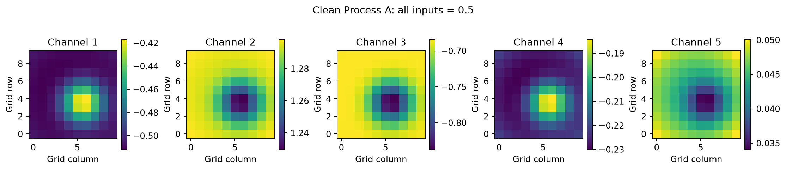

**Read this picture:** Each panel is one of A’s five channels. A color gives the value at that location. Bright does not automatically mean good; we have not defined an optimization objective yet.


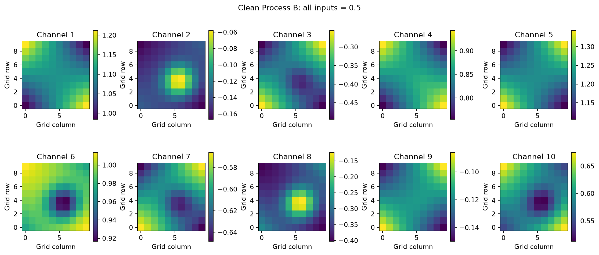

**Read this picture:** B produces ten channels. Each panel has its own color scale, so equal colors across channels can represent different numbers.


### Change one setting and watch one output

A three- or four-input function cannot be shown completely by one curve. Instead, hold all but one input at 0.5, vary the remaining input from 0 to 1, and watch channel 1 at row 6, column 7.

Each line below is one such slice. We repeat this for every input.


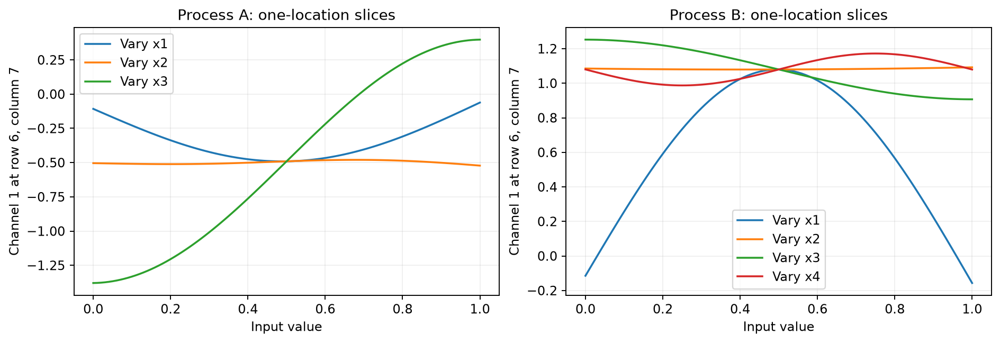

**Read this picture:** For this selected A output, changing x3 has a large effect while changing x2 has a smaller effect. B shows a curved x1 response. Another location or reference input setting can behave differently; these slices are not global feature-importance scores.


### Add imperfect observations

For the prediction experiment, we add independent normal noise with standard deviation **0.035** to the clean map values. A model trains on these noisy observations. Because we generated the data ourselves, we can still compare its predictions with the hidden clean answer.

**You should now be able to say:** “One input setting goes into a fixed synthetic function and produces several maps. The dataset contains input setting/map pairs. The models learn from noisy versions of those pairs.”

*Notebook connection: cells 1–4 set up the tools, define the function, and produce these pictures.*


## 2. Understand training and inference with a tiny map

Before comparing models, we need to understand what the prediction pipeline actually learns.

### Why compress the output?

Process A has 500 output numbers per input setting. Many of these values move together because the maps have repeated spatial structure. PCA looks for a small number of patterns that describe most of that variation.

Instead of predicting all 500 numbers directly, we ask the model to predict five numbers. These are called **PCA scores**. A stored PCA decoder then expands the five numbers into the full maps.

### Teaching example: compress a two-number map

Imagine each map has only two values. Three observed maps are:


| Training example | Map values |
| --- | --- |
| 1 | [1, 3] |
| 2 | [2, 4] |
| 3 | [3, 5] |


The second value always exceeds the first by 2. Both values rise together. Therefore, one changing number can describe these maps.

The mean map is **[2, 4]**. One normalized PCA direction is approximately **[0.7071, 0.7071]**. The scores are:


| Original map | Difference from mean | PCA score |
| --- | --- | --- |
| [1, 3] | [−1, −1] | −1.4142 |
| [2, 4] | [0, 0] | 0 |
| [3, 5] | [1, 1] | +1.4142 |


To reconstruct a map, use:

`map = mean map + score × direction`

For score `1.4142`, this gives approximately `[2,4] + [1,1] = [3,5]`.

Suppose the input-to-score predictor gives **0.7071** for a new input setting. The decoder produces approximately:

`[2,4] + 0.7071 × [0.7071,0.7071] = [2.5,4.5]`

That predicted score is hypothetical; it demonstrates decoding. This tiny example omits the scaling steps used in the real notebook. Also, PCA directions can have their signs reversed without changing the reconstructed maps.

### What if the PCA direction were [1, 2]?

> **Teaching example:** we keep the same centred point `[1, 1]` from the tiny map above and try a different direction. These are small illustrative numbers, not scores measured in the synthetic experiment.

The earlier score **1.4142** came from projecting `[1, 1]` onto the direction `[1, 1]`. PCA uses directions with length 1. For a direction `[1, 2]`, first calculate its length and divide both entries by it:

```text
Length = √(1² + 2²) = √5 = 2.2361
Unit direction = [1/√5, 2/√5] = [0.4472, 0.8944]
```

Calculate the score by multiplying corresponding entries and adding:

```text
Score = 1 × 0.4472 + 1 × 0.8944
      = 1.3416
```

Then use that one score to reconstruct the centred point:

```text
Reconstructed centred point = score × unit direction
                             = 1.3416 × [0.4472, 0.8944]
                             ≈ [0.6, 1.2]

Add the original mean back:
Reconstructed point = [2, 4] + [0.6, 1.2] = [2.6, 5.2]
```

The original point was `[3, 5]`, so this reconstruction has some error. The direction `[1, 2]` cannot represent `[1, 1]` perfectly using one score because they point in different directions. For these three tiny training maps, PCA would choose the `[1, 1]` direction (or its negative). In general, PCA learns directions from the training data to make the total squared reconstruction error as small as possible for the chosen number of components.

### There are two different things to learn

Let’s follow **Process A**, using the actual data sizes in the notebook, from generating examples to predicting a new output.

#### 1. What does one training example contain?

Process A takes **three input numbers**, called an input setting:

```text
Input setting = [input 1, input 2, input 3]
```

For each input setting, our synthetic function produces **five channels: A1 to A5**. Each channel is a 10 × 10 map containing 100 numbers.

```text
3 input numbers → 5 maps × 100 values = 500 output numbers
```

With 20 training input settings, we therefore have:

| Training data | Shape |
| --- | --- |
| input settings | 20 rows × 3 numbers |
| Corresponding observed outputs | 20 rows × 500 numbers |

Each row describes one whole input setting and its outputs. The prediction experiment uses noisy observations of those outputs for training.

#### 2. Why are there two things to learn?

We want to predict 500 output numbers from three inputs. We split this into two jobs:

```text
Job 1 — PCA:
Find a shorter way to describe the 500 output numbers.

Job 2 — GP, Random Forest, or MLP:
Learn how the three input numbers determine that shorter description.
```

#### 3. First, PCA compresses the training outputs

We give PCA the **20 rows of 500 output numbers**, after scaling the output channels. PCA finds an average output and five directions describing how the outputs vary between input settings. It then represents each input setting’s outputs using **five scores**:

```text
500 output values → PCA → 5 scores

For all 20 input settings:
20 rows × 500 output values → 20 rows × 5 PCA scores
```

These five scores describe the **whole collection of five maps together**. Score 1 does not mean channel A1, and score 3 does not mean channel A3. Each score can affect values across several channels and locations.

The directions PCA discovers can be mixtures of the original flat, bowl, wave, bump, and diagonal patterns. We choose five components because we know how the synthetic function was built. This is a deliberate advantage of this study; other datasets may need a different number of components. Compression can still lose information, especially observation noise, which is why we check reconstruction error later.

#### Check how well PCA compresses the outputs

This is a check of **PCA’s representation**. It asks how much training-output variation is retained by the selected components.

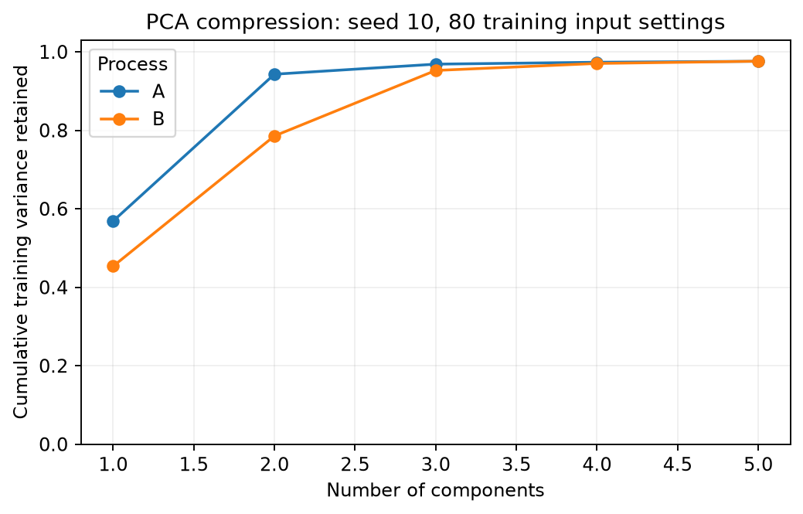

**Read this picture:** Each curve uses seed 10 and 80 training input settings. Move right to keep more components. The height tells us how much of the training-output variation those components retain. A retained-variance percentage is not a prediction-accuracy percentage.

The table below averages five repeats at each training size. Reconstruction RMSE compares clean test maps with reconstructions made from noisy test maps using the training-fitted PCA. This is the same kind of representation check as the dotted reference introduced in Experiment 1.

| Process | Training input settings | PCA variance retained | PCA reconstruction RMSE |
| --- | ---: | ---: | ---: |
| A | 20 | 98.04% | 0.02342 |
| A | 40 | 97.80% | 0.01574 |
| A | 80 | 97.62% | 0.01157 |
| A | 160 | 97.53% | 0.00910 |
| B | 20 | 98.16% | 0.02293 |
| B | 40 | 97.74% | 0.01548 |
| B | 80 | 97.46% | 0.01052 |
| B | 160 | 97.41% | 0.00763 |

This panel belongs with compression. GP uncertainty is assessed separately using interval coverage and interval width.

#### 4. Next, train a model to predict those scores

We pair each input setting with the five scores PCA calculated for its observed outputs:

| Model input | Model target |
| --- | --- |
| Input setting 1: three input values | Input setting 1’s five PCA scores |
| Input setting 2: three input values | Input setting 2’s five PCA scores |
| … | … |
| Input setting 20: three input values | Input setting 20’s five PCA scores |

The predictor learns:

```text
3 input values → 5 PCA scores
```

We try three choices for this predictor:

| Predictor | How it predicts the scores |
| --- | --- |
| GP | Uses relationships between input settings to predict each score, with an uncertainty estimate. Our implementation fits five separate GPs, one per score. |
| Random Forest | Combines the predictions of many decision trees to return five scores. |
| MLP | Learns weights in a neural network that returns five scores. |

All three choices receive the same training input settings and the same PCA representation for a given comparison.

That completes training: **PCA has learned how to compress and reconstruct outputs; the predictor has learned how to estimate their scores from an input setting.** PCA alone needs an output map to calculate its scores. The predictor lets us estimate scores when we have only the input setting.

#### 5. What happens when a new input setting arrives?

This step is called **inference**, meaning using what we already learned to make a prediction. We give the trained pipeline the three input numbers. Its output maps are unknown to the predictor.

```text
New input setting: 3 inputs
         ↓
Trained GP, Random Forest, or MLP
         ↓
5 predicted PCA scores
         ↓
PCA reconstruction
         ↓
500 predicted output values
         ↓
Arrange into five 10 × 10 maps
```

PCA reconstruction uses the same idea as the tiny example:

```text
Reconstructed output in scaled units
    = learned average output
    + predicted score 1 × learned direction 1
    + predicted score 2 × learned direction 2
    + ...
    + predicted score 5 × learned direction 5
```

The notebook also rescales the numbers so the methods can work with values of comparable size. During training, it learns input scaling, channel scaling, PCA, and score scaling using the training examples only.

For a new input setting, the exact order is:

1. Apply the saved input scaling to its three numbers.
2. Predict five scaled scores.
3. Reverse score scaling to get scores in the units PCA uses.
4. Reconstruct the 500 values with the saved PCA mean and directions.
5. Reverse channel scaling and arrange the values into five maps.

We reuse the learned settings. The new input setting’s true outputs are not used in these steps.

#### The same flow for GP, Random Forest, and MLP

Think of **PCA as a way to translate 500 map values into five scores**, and translate those scores back into maps. The predictor learns to estimate those five scores from an input setting.

```text
TRAINING
20 input settings                         Their 20 observed outputs
3 inputs per input setting                500 map values per input setting
                                            ↓
                                    Fit PCA on these maps
                                            ↓
                                    5 scores per input setting
         │                                  │
         └─────────────────┬────────────────┘
                           ↓
                   Train the predictor:
                    3 inputs → 5 scores
```

We save PCA, the predictor, and the scaling settings. At inference, the PCA steps stay the same for all three methods:

```text
New input setting → trained GP            → five predicted scores → saved PCA decoder → five maps
New input setting → trained Random Forest → five predicted scores → saved PCA decoder → five maps
New input setting → trained MLP           → five predicted scores → saved PCA decoder → five maps
```

The saved scaling steps are applied and reversed in each pipeline. The new input setting’s actual maps are not needed to produce a prediction.

| Predictor | What it learns |
| --- | --- |
| GP | Relationships between input settings, using five separate GPs—one for each score |
| Random Forest | Many decision trees whose predictions are averaged to produce five scores |
| MLP | Neural-network weights that turn three inputs into five scores |

After prediction, we use test outputs for two checks:

| Check in this notebook | GP | Random Forest | MLP |
| --- | --- | --- | --- |
| Compare predicted maps with clean ground-truth maps using RMSE | Yes | Yes | Yes |
| Check predicted score intervals against observed scores | Yes | Not implemented | Not implemented |

The GP returns uncertainty for its scores. The later uncertainty section checks those ranges. Random Forest and MLP follow the same training, reconstruction, and RMSE flow; our implementations do not return score intervals.

#### 6. Where does the A3 value −0.090171 fit?

Earlier, the synthetic function gave **−0.090171 at one selected location in A3**, for input setting `[0.2, 0.6, 0.8]`.

If we ask the trained pipeline to predict that input setting, it produces all 500 output values. One of them corresponds to that exact A3 location. We could then compare:

```text
True value from the synthetic function: −0.090171
Predicted value from the trained model: whatever the model produces
```

The earlier table calculates the true value. It does not report a trained-model prediction for this input setting. This input setting is a walkthrough example; the benchmark uses its own randomly sampled, held-out test input settings.

#### 7. How this leads into Experiment 1

We now have three complete prediction pipelines:

```text
Input setting → GP            → PCA scores → output maps
Input setting → Random Forest → PCA scores → output maps
Input setting → MLP           → PCA scores → output maps
```

Experiment 1 asks: **Which pipeline predicts unseen input settings most accurately, and how does that change as we provide more training input settings?**

We train with 20, 40, 80, and 160 input settings, then compare the predicted maps with the true synthetic maps for separate test input settings. The test answers are used to measure error after prediction; they are never used to fit PCA or train the predictors.

*Notebook connection: cell 5 defines preprocessing, the GP, reconstruction, and the error calculation; cell 6 performs training and inference repeatedly.*


## 3. Experiment 1 — Find out which predictor works best here

### Set up a fair test

The **test input settings are newly generated input settings**, separate from the input settings used for training. We use the **same fixed synthetic function** to calculate the correct outputs for both sets.

For each process, we use five sampling seeds: **10, 20, 30, 40, 50**. Each seed generates a pool of 160 training input settings and 120 separate test input settings. A different seed changes the sampled input settings and noise; the underlying function stays fixed.

#### A real example: Process A, seed 10, 20 training input settings

Each input is randomly selected between 0 and 1. These are the actual 20 training input settings from that run, rounded to six decimals:

| Training input setting | Input 1 | Input 2 | Input 3 |
| --- | ---: | ---: | ---: |
| 1 | 0.218533 | 0.260585 | 0.049452 |
| 2 | 0.538599 | 0.542071 | 0.789054 |
| 3 | 0.912337 | 0.372263 | 0.325775 |
| 4 | 0.655661 | 0.896986 | 0.651696 |
| 5 | 0.783387 | 0.874239 | 0.192224 |
| 6 | 0.610154 | 0.945718 | 0.819394 |
| 7 | 0.225289 | 0.545599 | 0.871749 |
| 8 | 0.801430 | 0.033999 | 0.092811 |
| 9 | 0.762075 | 0.768683 | 0.119208 |
| 10 | 0.112717 | 0.488293 | 0.377578 |
| 11 | 0.048446 | 0.557338 | 0.822935 |
| 12 | 0.096000 | 0.435693 | 0.278856 |
| 13 | 0.411281 | 0.176976 | 0.360102 |
| 14 | 0.147541 | 0.704831 | 0.632347 |
| 15 | 0.374185 | 0.429076 | 0.048139 |
| 16 | 0.404000 | 0.836557 | 0.450986 |
| 17 | 0.846887 | 0.687955 | 0.068568 |
| 18 | 0.576623 | 0.044302 | 0.170124 |
| 19 | 0.042466 | 0.642395 | 0.511390 |
| 20 | 0.989659 | 0.984226 | 0.027737 |

For every row, we run the synthetic function:

```text
Training input setting 1
[0.218533, 0.260585, 0.049452]
                  ↓
         Synthetic function
                  ↓
      500 clean output values
                  ↓
         Add observation noise
                  ↓
      500 observed training values
```

PCA and the predictor learn from these **20 input setting/output pairs**. The actual calculations use full-precision inputs; the table is rounded for reading.

#### Where do the test input settings come from?

We generate **another 120 random input settings**. These are the first three from the same run:

| Test input setting | Input 1 | Input 2 | Input 3 |
| --- | ---: | ---: | ---: |
| 1 | 0.652034 | 0.398686 | 0.621278 |
| 2 | 0.557083 | 0.676415 | 0.303885 |
| 3 | 0.495522 | 0.851212 | 0.120903 |

For test input setting 1, we take two paths:

```text
                [0.652034, 0.398686, 0.621278]
                              │
              ┌───────────────┴───────────────┐
              ↓                               ↓
     Trained PCA + GP                Synthetic function
              ↓                               ↓
   500 predicted values              500 correct values
              │                               │
              └───────────────┬───────────────┘
                              ↓
                Compare to measure error
```

**The model receives only the test input setting’s three inputs.** We keep the correct outputs for checking its predictions afterward. We repeat this for all 120 test input settings and combine their errors into one RMSE. Random Forest and MLP are evaluated on the same test input settings.

#### Why generate 160 training input settings if this row uses only 20?

The notebook prepares a pool so it can compare different training sizes fairly:

```text
Training pool: 160 input settings
    20-setting experiment → use the first 20
    40-setting experiment → use the first 40
    80-setting experiment → use the first 80
   160-setting experiment → use all 160

Separate test set: 120 input settings → assess every training size
```

For the **20-setting experiment**, the other 140 training-pool input settings do not participate in fitting. The test input settings come from a separate random draw. Whole input settings stay in one set; pixels from one input setting are not divided between training and testing.

Because this is a synthetic study, we can calculate the correct outputs for new input settings using the known function. With measured data, obtaining those test outputs would require additional measurements or experiments.

### Turn prediction errors into a score

> **Teaching example:** true values `[2,4]`, predicted values `[2.5,3.5]`.

The errors are `[+0.5,−0.5]`. Their squared values are `[0.25,0.25]`. The mean squared error is **0.25**. Its square root, **RMSE**, is **0.5**.

We use the same calculation across all test input settings, locations, and channels. Smaller RMSE means a closer prediction. It is in output units, not percent accuracy.

### Read the measured prediction results

Every entry below is **mean RMSE ± one sample standard deviation across five repeats**, compared with clean test maps.


| Process | Training input settings | GP | Random Forest | MLP |
| --- | --- | --- | --- | --- |
| A | 20 | 0.03583 ± 0.00278 | 0.23891 ± 0.02166 | 0.07644 ± 0.01710 |
| A | 40 | 0.02034 ± 0.00252 | 0.17895 ± 0.00854 | 0.03447 ± 0.00486 |
| A | 80 | 0.01200 ± 0.00124 | 0.14152 ± 0.01226 | 0.02517 ± 0.00758 |
| A | 160 | 0.00785 ± 0.00054 | 0.11664 ± 0.00954 | 0.02233 ± 0.00366 |
| B | 20 | 0.07763 ± 0.02463 | 0.23718 ± 0.01738 | 0.11228 ± 0.02761 |
| B | 40 | 0.03868 ± 0.00135 | 0.21251 ± 0.00868 | 0.06562 ± 0.02577 |
| B | 80 | 0.01652 ± 0.00581 | 0.20395 ± 0.01212 | 0.03730 ± 0.00712 |
| B | 160 | 0.00912 ± 0.00140 | 0.16657 ± 0.01372 | 0.02615 ± 0.00451 |


### How the “A, 20” row is aggregated

**20 means the number of training input settings.** Each model’s entry combines errors in two stages.

**First, calculate one error for one run.** Train on 20 input settings, then predict outputs for 120 separate test input settings. Each Process An input setting produces 5 channels × 10 × 10 locations = 500 output values. Therefore, that run compares:

```text
120 test input settings × 500 values = 60,000 predicted values
```

For every value, calculate the difference between the prediction and the true, clean synthetic value. Then:

```text
One run’s RMSE = √(sum of all 60,000 squared differences ÷ 60,000)
```

This produces **one error number covering all test input settings, channels, and locations**, with equal weight for each value. We calculate this error after reconstructing the maps and reversing the scaling.

**Second, repeat five times and summarize.** Each random seed gives its own training and test input settings. Within a repeat, GP, Random Forest, and MLP use the same data.

For **GP with 20 Process A training input settings**, the actual results were:

| Repeat seed | RMSE across its 60,000 test values |
| --- | ---: |
| 10 | 0.037794 |
| 20 | 0.033236 |
| 30 | 0.036360 |
| 40 | 0.032710 |
| 50 | 0.039040 |

Average those five RMSE values:

```text
Mean RMSE = (0.037794 + 0.033236 + 0.036360
             + 0.032710 + 0.039040) ÷ 5
          ≈ 0.03583
```

Their sample standard deviation is **0.00278**, giving the table entry **0.03583 ± 0.00278**. The calculations use the unrounded run results.

The Random Forest and MLP entries are calculated in the same way:

| Model | Average RMSE across five repeats | Variation across repeats |
| --- | ---: | ---: |
| GP | 0.03583 | ± 0.00278 |
| Random Forest | 0.23891 | ± 0.02166 |
| MLP | 0.07644 | ± 0.01710 |

So **0.03583 ± 0.00278 means the GP’s average test error and how much that error varied across five runs**. The ± value is not the GP’s uncertainty for an individual prediction.

### Read the prediction-error graph

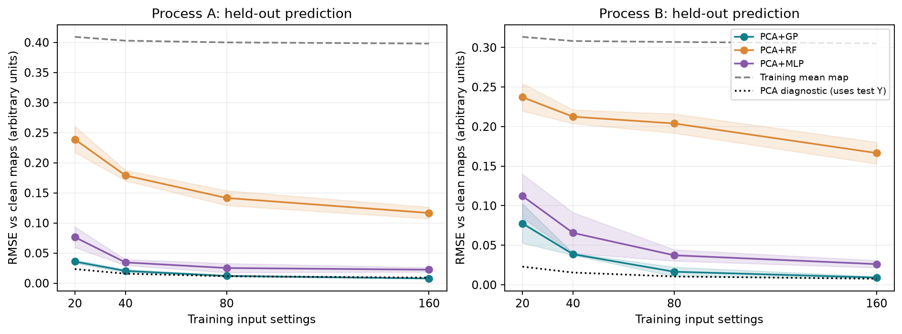

**Read this picture:** Choose one panel. Move right to increase the training data and look for lower error. Each colored band is one standard deviation across repeats; it is not a 95% confidence interval.


### Exactly what do the dashed gray and dotted lines compare?

Both lines calculate RMSE against the **same correct answer: the clean synthetic outputs of all 120 test input settings**.

What changes is the output we compare with that answer:

| Line | What we compare with the clean test outputs |
| --- | --- |
| **Dashed gray: average-map baseline** | The average of the **training maps**, repeated for every test input setting |
| **Dotted: PCA diagnostic** | Each test input setting’s **noisy output maps after PCA compression and reconstruction** |

The average training map is calculated separately at each matching channel and location. The dotted line uses the saved PCA and output scaling learned on training data to compress and reconstruct the noisy test maps.

> **Teaching example:** the following values illustrate one comparison. They are not measured values from the experiment.

For **one test input setting, one channel, one location**, imagine these values:

```text
Correct clean test value:                   1.00

Average training value at that location:    0.70
PCA reconstruction of the noisy test value: 1.04
```

The errors contributing to RMSE are:

```text
Dashed gray: (0.70 − 1.00)² = 0.09
Dotted PCA:  (1.04 − 1.00)² = 0.0016
```

We repeat that comparison across **all 120 test input settings × 5 channels × 100 locations = 60,000 values** for Process A.

For each line separately:

```text
RMSE = √(average of its 60,000 squared errors)
```

Then we repeat the experiment five times and plot the average RMSE. For Process B, the corresponding count is 120 × 10 × 100 = 120,000 values per run.

The key difference: **the gray line uses training outputs to make its guess; the dotted line uses the noisy test outputs themselves to make its reconstruction.** Both are checked against the clean test outputs. The dotted line checks compression and reconstruction; its access to noisy test outputs means it does not measure prediction from an input setting alone.

### Why include these two reference lines?

The **dashed gray line** asks: “Does using the input setting actually help?” It always predicts the average training maps. A model below this line has lower error than always guessing the average. All three trained methods beat this baseline in our experiment.

The **dotted PCA line** asks: “How much error comes from compressing and reconstructing maps?” It receives noisy test maps and passes them through PCA, without using GP, Random Forest, or MLP. Low error suggests that five scores can describe the maps well. If a trained model has much higher error, predicting scores from the input setting is likely a bigger difficulty than representing the maps with PCA.

This is a guide rather than an exact separation of errors. The dotted line starts with noisy test outputs, so it is not a guaranteed minimum prediction error. **The gray line checks whether learning helps; the dotted line checks whether PCA represents the outputs well.**

**Measured finding:** GP has the lowest mean error at all tested sizes in this final configuration. At 20 input settings, A’s GP error is 0.03583 and B’s is 0.07763. This supports GP for these particular low-data, smooth synthetic tasks. It does not establish that GP is universally best.

### Look at mistakes on one map


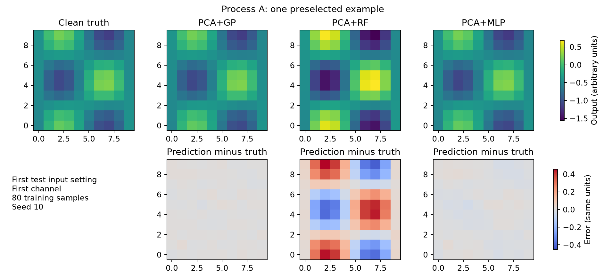

**Read this picture:** Top row: clean truth and predictions. Bottom row: prediction minus truth. Positive error means overprediction; negative error means underprediction. Shared color scales make the models comparable within this figure.


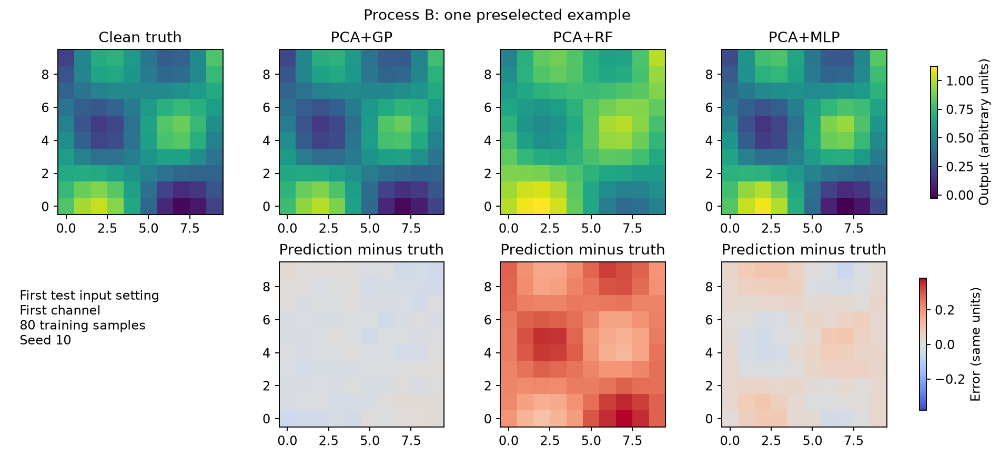

**Read this picture:** This is also one preselected example: seed 10, 80 training input settings, first held-out input setting, first channel. The score table uses every test input setting and channel, not just this picture.


### Check whether GP uncertainty is believable

This section checks **whether the GP’s uncertainty estimates match what happens on test data**.

You already know the prediction flow:

```text
New input setting → GP → five predicted scores → PCA decoder → predicted maps
```

For each score, the GP also gives an uncertainty estimate. We check that estimate **before decoding the scores into maps**.

#### 1. The GP predicts a score and a range

> **Teaching example:** these small numbers illustrate an interval; they are not measured scores from the study.

Suppose, for one test input setting, the GP predicts:

```text
Score 1: best guess = 3
         standard deviation = 0.5
```

We calculate an approximate 95% interval:

```text
3 ± 1.96 × 0.5 = [2.02, 3.98]
```

Across many predictions, the aim is for these intervals to contain the observed scores about 95% of the time under the model’s assumptions. The GP is expressing uncertainty about **score 1**, so the answer we check must also be a score.

#### 2. Convert the observed test maps into scores

We already have the test input setting’s noisy observed maps. Pass them through the **saved PCA and scaling** to calculate their five observed scores.

```text
Test input values → GP → predicted score 1 and its interval

Observed test maps → saved PCA and scaling → observed score 1
```

PCA is reused here; it is not trained again. Suppose the observed score 1 is **3.4**:

```text
Predicted interval: [2.02, 3.98]
Observed score:      3.4

Inside? Yes.
```

If the observed score were **4.3**, the answer would be **No**.

**Why use PCA if we already have the ground truth?** We have maps containing 500 values, while the GP’s intervals describe five scores. PCA converts the maps into the same form as the quantities the GP predicts. We cannot directly compare a score interval with map values.

| What we check | What we compare |
| --- | --- |
| Prediction accuracy, using RMSE | Reconstructed predicted maps against clean ground-truth maps |
| GP uncertainty coverage | Predicted score intervals against scores calculated from noisy observed test maps |

Our intervals include observation noise, so this check uses noisy observed maps. Intervals for the underlying clean scores would require a different uncertainty calculation.

#### 3. Count how often the intervals contain the observed scores

We do this for all five scores of all 120 test input settings:

```text
120 input settings × 5 scores = 600 checks per run
```

For illustration, if 570 of those 600 checks succeed:

```text
Coverage = 570 ÷ 600 × 100 = 95%
```

That would match the intended coverage. We repeat the study five times and average the measured coverage. These checks are not all independent.

#### 4. Read our actual results

| Process | Training input settings | Intended coverage | Measured coverage | Mean interval width |
| --- | ---: | ---: | ---: | ---: |
| A | 20 | 95% | 88.47% | 0.9568 |
| A | 40 | 95% | 92.27% | 0.5805 |
| A | 80 | 95% | 94.33% | 0.4137 |
| A | 160 | 95% | 95.27% | 0.3554 |
| B | 20 | 95% | 93.07% | 1.2005 |
| B | 40 | 95% | 92.97% | 0.6093 |
| B | 80 | 95% | 96.30% | 0.2798 |
| B | 160 | 95% | 94.73% | 0.1713 |

For **A with 20 training input settings**, coverage was 88.47%: too many observed scores fell outside the intervals. The GP was more confident than these test results justified. B’s coverage was 93.07%.

With **160 training input settings**, coverage was 95.27% for A and 94.73% for B, close to the intended 95%. These are measured results on our test sets, rather than a guarantee for future data.

#### 5. Why also show interval width?

A very wide interval can contain almost every answer while giving little useful guidance.

```text
Narrow interval:  [2.9, 3.1]
Wide interval:    [−100, 100]
```

We therefore check both:

- **Coverage:** Do the intervals contain observed scores about as often as intended?
- **Width:** How broad are those intervals?

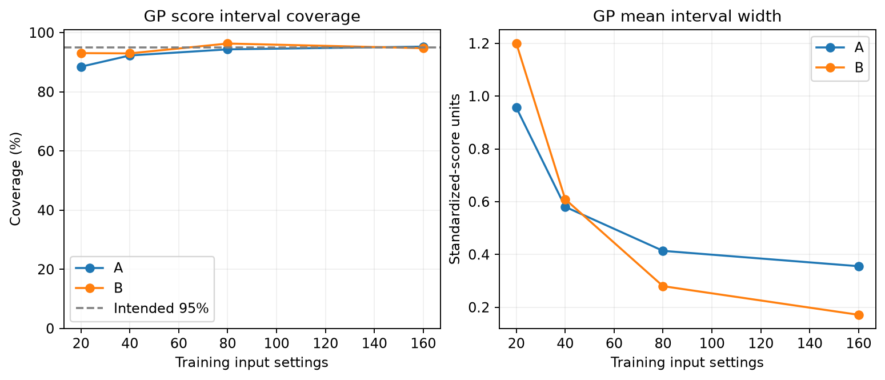

**Read this picture:** The left panel shows measured coverage. Compare each curve with the dashed 95% target line. The right panel shows mean interval width in standardized-score units. We want coverage near its intended level together with useful, reasonably narrow ranges. Narrower ranges alone do not prove better uncertainty.

Only these two panels belong in the GP uncertainty check. The PCA variance panel has been moved to the compression explanation because it answers a separate question.

Here, **95% refers to coverage of individual score intervals across many checks**. It does not mean the maps are 95% accurate or that the whole map is covered with 95% probability. These checks also omit some uncertainty associated with learning the PCA representation.

**Why move on?** GP predicted reasonably well here and gives an uncertainty estimate we can inspect. The next question is whether those predictions can help us decide which input to evaluate. That requires a separate experiment.

*Notebook connection: cells 6–9 generate the comparison, learning curves, map examples, and uncertainty checks.*


## 4. Experiment 2 — PCA + GP BO

**Experiment 2 uses the PCA+GP model to choose input settings that produce outputs close to a desired target.**

It repeatedly does this:

```text
Predict what might happen → choose one input setting → evaluate it
→ observe what actually happened → update the model → choose again
```

Let’s follow **Process A, seed 10**, from beginning to end. All numerical values below come from the executed synthetic experiment.

### 1. What goes into the process, and what comes out?

One input setting contains three numbers:

```text
[input 1, input 2, input 3]
```

The synthetic function takes these numbers and produces five output maps. Each map has 10 × 10 values:

```text
3 input values → 5 maps × 100 values = 500 output values
```

The output maps describe how the process behaved at that input setting.

In this experiment, **evaluating an input setting** means running the synthetic function and adding observation noise. The resulting maps are our observed data.

### 2. What output do we want?

Before searching, we define five **target maps** containing the 500 output values we want the process to produce.

In the notebook, we create those target maps using:

```text
[0.35, 0.65, 0.45] → synthetic function → target maps
```

That is how we construct the desired result for this synthetic example.

The search receives the **target maps to match**. We do not give it those three input numbers as a suggested solution.

We want an input setting that produces similar **outputs**. Its input numbers do not necessarily need to equal `[0.35, 0.65, 0.45]`.

### 3. How do we decide whether an input setting is good?

After evaluating an input setting, compare its 500 observed output values with the 500 matching target values.

At every channel and location:

```text
Squared difference = (observed value − target value)²
```

Then average all 500 squared differences:

```text
MSE = sum of the 500 squared differences ÷ 500
```

This gives **one number for that input setting**.

- Small MSE: its outputs are close to the target.
- Large MSE: its outputs are farther from the target.
- Zero MSE: all 500 values match exactly.

This MSE describes target matching. It is different from Experiment 1’s RMSE, which measured how accurately a model predicted test outputs.

### 4. What information do we already have?

We start with the same **20 training input settings and their observed maps** from Experiment 1.

Those initial settings were randomly generated by Python. BO did not choose them.

For each setting, we already have:

```text
Three input values + 500 observed output values
```

We compare those existing observed maps with the target maps. That lets us judge how good the initial settings already are.

For this run, the best initial result was:

```text
Initial trial 16:
[0.404000, 0.836557, 0.450986]

Observed MSE = 0.0037239
```

So our starting question is:

> Can BO find an input setting whose observed MSE is lower than 0.0037239?

The separate test examples from Experiment 1 are not used to guide this search.

### 5. Where does PCA+GP fit into this?

We rebuild the same prediction pipeline using those 20 training examples.

First, PCA compresses each observed collection of 500 values into five scores:

```text
500 observed output values → PCA → five scores
```

Then five GPs learn to predict those scores from the input setting:

```text
Three input values → five GPs → five predicted scores
```

The saved PCA decoder converts predicted scores back into maps:

```text
Five predicted scores → PCA decoder → 500 predicted output values
```

The scaling steps prepare the numbers for the models and convert them back afterward.

**The GPs still predict PCA scores. They are not trained to predict MSE directly.**

MSE is calculated afterward by comparing the reconstructed maps with the target maps.

### 6. Where do the possible new input settings come from?

Python generates a list of **1,500 candidate input settings**, with each input between 0 and 1.

For each candidate, we initially know only its three input numbers. We have not evaluated its outputs.

The candidate list is created once. BO repeatedly chooses from its remaining untried entries.

So the roles are:

```text
Python generates possible input settings.
GP predicts what their outputs might be.
BO chooses which one to evaluate next.
```

### 7. What does the GP predict for a candidate?

The first candidate selected in this run had these inputs:

```text
[0.627722, 0.660143, 0.450525]
```

Before evaluating it, the GPs predicted:

| PCA score | Predicted value | Standard deviation |
| --- | ---: | ---: |
| 1 | −0.3738 | 0.0482 |
| 2 | −0.9013 | 0.0588 |
| 3 | +0.7825 | 0.1363 |
| 4 | −1.1006 | 0.2604 |
| 5 | −0.6643 | 0.9498 |

The predicted value is the GP’s best guess for that score.

The standard deviation describes uncertainty about that guess. A larger value means more uncertainty.

These are standardized PCA scores. They are neither map values nor target-matching errors.

At this point, we still have not observed what this candidate actually produces.

### 8. How does BO use those predictions to choose a candidate?

BO needs to consider both:

- How good the candidate’s outputs might be.
- How uncertain those outputs are.

For each candidate, we generate **128 possible sets of five scores** using the GP’s predicted values and uncertainties.

Each possible set is decoded into maps and compared with the target:

```text
Possible set of five scores
              ↓
Decode into 500 possible output values
              ↓
Compare with the target maps
              ↓
One possible MSE
```

For the candidate above, the first five possible MSEs were:

```text
0.0021921
0.0008005
0.0005324
0.0003093
0.0012790
```

These are possibilities generated by the model, not observed trial results.

Our current best observed MSE is **0.0037239**. For each possible outcome, calculate:

```text
Improvement = max(0.0037239 − possible MSE, 0)
```

A possible result worse than our current best contributes zero improvement.

Average the improvements across all 128 possibilities. This estimates **Expected Improvement**.

For this candidate:

```text
Estimated Expected Improvement = 0.0027989
```

BO performs the same calculation for the other candidates. This candidate has the highest estimated improvement, so BO chooses it.

**The 128 possibilities are computer calculations. They are not 128 new process trials.**

### 9. What happens after BO chooses the input setting?

Now we actually evaluate it:

```text
Selected inputs:
[0.627722, 0.660143, 0.450525]
              ↓
Run the synthetic function and add observation noise
              ↓
Obtain five observed maps
              ↓
Compare all 500 values with the target maps
              ↓
Observed MSE = 0.0017529
```

Now we have an actual observed result:

```text
Previous best observed MSE: 0.0037239
New observed MSE:           0.0017529
```

The new input setting performs better, so it becomes our current recommendation.

This is **trial 21**: the original 20 trials plus one BO-selected trial.

### 10. What exactly do we use to update the model?

We have newly observed maps from trial 21. Convert those maps into five scores using the saved PCA and scaling.

The calculated scores were:

```text
[−0.3872, −0.9610, +0.9213, −0.7641, −0.6825]
```

We add this training example:

```text
Input setting:
[0.627722, 0.660143, 0.450525]

Observed scores:
[−0.3872, −0.9610, +0.9213, −0.7641, −0.6825]
```

Before choosing the next candidate, refit the five GPs using **21 examples instead of 20**.

PCA and the scaling settings remain fixed. This keeps the meaning of each score consistent.

There are two separate uses of the new maps:

| Use | What we calculate |
| --- | --- |
| Decide whether the trial improved our result | MSE against the target maps |
| Teach the GPs what happened at these inputs | PCA scores calculated from the observed maps |

We do not treat the model’s guesses for untried candidates as observations.

### 11. How does the loop continue, and when does it stop?

Using the updated GPs:

```text
Predict remaining candidates
              ↓
Estimate their improvement
              ↓
BO selects another input setting
              ↓
Evaluate it and obtain observed maps
              ↓
Update the GPs before the next choice
```

The next actual results were:

| Trial | Observed MSE of that trial | Best observed MSE so far |
| --- | ---: | ---: |
| 21 | **0.0017529** | **0.0017529** |
| 22 | 0.0018409 | 0.0017529 |
| 23 | 0.0020848 | 0.0017529 |

Trials 22 and 23 added information but did not improve the best result.

We stop after **24 additional trials**:

```text
20 initial trials + 24 additional trials = 44 total trials
```

In this particular run, trial 21 remained the best observed result through trial 44.

The final recommendation is the input setting with the lowest **observed** MSE among the trials we actually performed.

### 12. How do we check whether BO helped?

We compare it with random search.

Both methods receive:

```text
The same initial 20 observations
The same target maps
The same candidate list
24 additional trials
```

Random search chooses its additional settings randomly. BO chooses using the PCA+GP model.

After each method selects its final recommendation, we assess that recommendation using the clean synthetic function, without added noise:

| Method, Process A, seed 10 | Clean MSE of recommended setting |
| --- | ---: |
| PCA+GP BO | **0.0006158** |
| Random search | 0.0022203 |

The clean errors are used only for assessment. They do not guide the search or determine which setting it recommends.

Across five starting datasets, BO produced a better recommendation than random search in all five runs for both processes.

**The essential connection is that Experiment 1 builds the map predictor; Experiment 2 repeatedly uses that predictor to select a new input setting, obtains a fresh observation, and learns from it.**

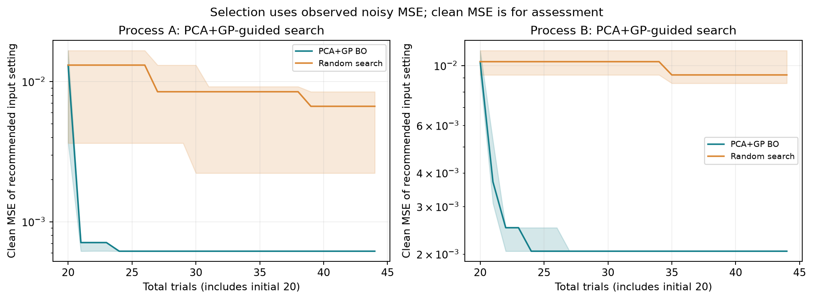

The graph shows median clean MSE across five runs, with the middle half shaded. The horizontal axis counts all trials, including the initial 20, and the vertical scale is logarithmic. A recommendation’s clean error can rise because recommendations use noisy observations.


## 5. Experiment 3 — Ask for one output value using an ID

### Start with the problem we want to solve

A outputs 500 numbers per input setting, while B outputs 1,000. Their inputs also have different lengths. A single conventional model cannot simply switch its input and output array sizes whenever the process changes.

Instead of asking for the whole map collection at once, ask one question:

**“For input setting `[0.2,0.6,0.8]`, at row 6, column 7, what is output A-3?”**

The answer is one number. We calculated the clean answer near the beginning: **−0.090171**. That number illustrates the target of the query, not a claimed fitted-model prediction.

Changing the ID asks for another channel. Changing the location asks for another point. Changing the input setting changes the operating settings.

**An ID alone is not enough.** “A-3” names an output; it does not specify its changing value.

### Give every query the same shape


| Part | Our A example | Why it is included |
| --- | --- | --- |
| Four input setting slots | [0.2, 0.6, 0.8, 0] | A has only three settings, so its fourth slot is a placeholder. |
| Four presence bits | [1, 1, 1, 0] | Tell the model that the fourth setting is absent, rather than a genuine zero. |
| Two location coordinates | Approximately [0.5556, 0.3333] | Specify column 7 and row 6 on the normalized grid. |
| Fifteen output-ID flags | A-3 flag = 1; all other flags = 0 | Specify which channel the question concerns. |


That gives **25 input features and one scalar output** for every query. A real zero in B’s fourth input would have presence bit 1.

The IDs are A-1…A-5 and B-1…B-10. Their one-hot flags avoid inventing a numerical distance between arbitrary labels. A-1 and B-1 remain different outputs because their meanings in this generator differ.

No extra process-ID column is needed: the global output ID already identifies its process. The interface is shared, but the model is not ignorant of process identity.

### Training and inference for this model

**Training:** turn each observed input setting/location/channel value into a query row and its target. Fit one neural network on rows from both processes. Scale the output values per channel using training observations only.

**Inference:** build a query for a new input setting, location, and known output ID; predict one normalized value; undo that channel’s output scaling. To reconstruct whole maps, issue all the necessary queries in a batch: 500 for A or 1,000 for B.

There is no PCA decoder in this experiment. The shared neural network predicts scalar values directly. Its learned weights are what the processes share.

### Compare sharing with a fair reference

We compare that one pooled network with **two separate scalar networks**, one per process. Both methods use the same query format, architecture, and observed labels for each process.

For each of three seeds—101, 202, 303—each process has **40 training input settings and 60 separate test input settings**. Training observes only 25 locations per input setting: row and column indices `[0,2,4,6,9]`, giving a 5 × 5 selection. Testing predicts all 100 locations, so it includes unseen input settings and some unobserved locations.

A provides 5,000 scalar training labels and B provides 10,000. These are still only 40 distinct training input settings per process. The pooled model sees both sets; each separate model sees its own set. The two separate networks collectively have more parameters than the one pooled network, so this is not a perfect capacity-matched test.

**Do not compare this error directly with the earlier PCA errors.** The training observations, sampling seeds, and prediction task differ. The matched comparison is shared scalar versus separate scalar.

### Measured sharing results


| Process | Separate mean RMSE ± SD | Shared mean RMSE ± SD | Reduction in mean error |
| --- | --- | --- | --- |
| A | 0.14225 ± 0.00674 | 0.13662 ± 0.00698 | 4.0% |
| B | 0.11187 ± 0.02216 | 0.10663 ± 0.00901 | 4.7% |


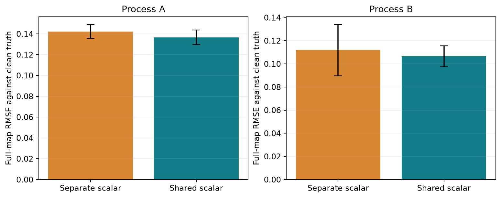

**Read this picture:** Lower bars are better. Error bars show one standard deviation across three splits, not confidence intervals. The average advantage from sharing is small.


**Measured finding:** sharing lowers mean error by about **4.0% for A** and **4.7% for B**. It wins three of three paired A splits and two of three B splits. For B at seed 303, the separate model is better: RMSE 0.09062 versus shared 0.09842.

This is encouraging but limited. Three splits on related synthetic functions cannot establish that sharing generally helps.


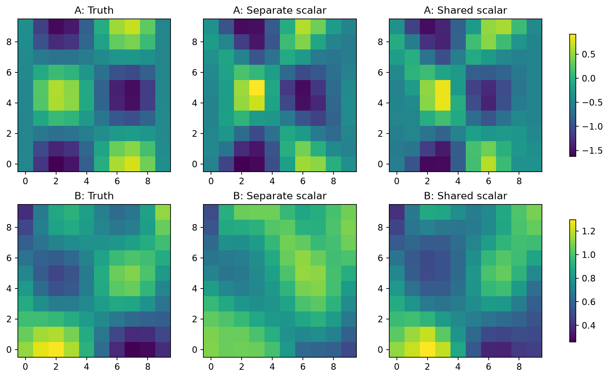

**Read this picture:** These are first-channel examples from seed 101, using the first test input setting for each process. They show where predictions differ; the reported scores include every test input setting and channel.


### What the result does and does not establish

It establishes that one fixed-size input query and one scalar output can serve both schemas. The shared model achieved a small average gain under this setup.

It does not establish a universally meaningful latent space, or prediction for an unseen process or unseen output ID. The model has learned the known IDs. It cannot be claimed from the current experiment setting that merely creating a new label would not teach it a new response function, taking into consideration the data constraints, simulation assumptions chosen for this experiment.
