# Gaussian Processes and Bayesian Optimization
## Illustrated, from-scratch refresher: Gaussian distributions → GP priors → regression → acquisition functions → Probability of Improvement

> **Illustrated edition:** Figures are stored in the adjacent `GP_BO_illustrated_assets/` folder. Keep the Markdown file and this folder together.
>
> **Purpose:** Read this document on its own to rebuild the concepts discussed in the lecture slides, including the specific points that were confusing. It starts with basic probability and moves gradually to the maximization of Probability of Improvement (PI).
>
> **Scope:** Primarily scalar-valued regression and **maximization** of an expensive, unknown objective. Numerical examples are illustrative unless explicitly identified as calculations.

---

## How to use this guide

- **If you have forgotten everything:** Start at Section 1 and follow the examples.
- **If you remember Gaussian distributions but not GPs:** Start at Section 3.
- **If you understand GP regression but not BO:** Start at Section 8.
- **If you forget how samples become predictions:** Jump to the **illustrated Section 6.6** (prior → posterior → sampled functions → query $x_*$ → mean/variance).
- **If you only need to revisit the latest question:** Read Sections 9–11, especially *why maximizing a monotonic CDF is equivalent to maximizing its input*.
- **Before a quiz or interview:** Read the complete BO iteration (Section 12), then test yourself against the three traps (Section 11.6).

### The complete storyline

```text
Gaussian distribution: uncertainty about a number
        ↓
Multivariate Gaussian: uncertainty about several related numbers
        ↓
Gaussian Process (GP): uncertainty about an entire function
        ↓
GP prior: possible functions before observing training data
        ↓
Condition on observed data → GP posterior
        ↓
At a new x*: predicted mean μ(x*) and uncertainty σ(x*)
        ↓
Bayesian Optimization (BO): choose which x to evaluate next
        ↓
Acquisition function: score how useful each candidate x is
        ↓
PI: probability of beating the best observed value
        ↓
Maximize PI (or its standardized input) to choose x_next
        ↓
Evaluate true objective at x_next; update GP; repeat
```

---

# Part I — Probability foundations

## 1. Gaussian distributions: one variable, multiple variables, and uncertainty

### 1.1 Univariate Gaussian: uncertainty about **one number**

A Gaussian (normal) random variable is written

$$
X\sim\mathcal N(\mu,\sigma^2).
$$

- $\mu$ = **mean** (center of the bell curve).
- $\sigma^2$ = **variance** (a measure of spread, in squared units).
- $\sigma=\sqrt{\sigma^2}$ = **standard deviation** (spread, in the same units as $X$).

Example: $X\sim\mathcal N(50,10^2)$ says the average is 50 and the standard deviation is 10. It **does not** mean every draw equals 50.

The probability density function (PDF) is

$$
p(x)=\frac{1}{\sqrt{2\pi\sigma^2}}\exp\left(-\frac{(x-\mu)^2}{2\sigma^2}\right).
$$

**Very important:** For a continuous random variable, the **height** of the PDF at a point is *not* the probability of that exact value. Probabilities are **areas under** the PDF across intervals.

### 1.2 PDF versus CDF: red curve versus green curve in the first slide

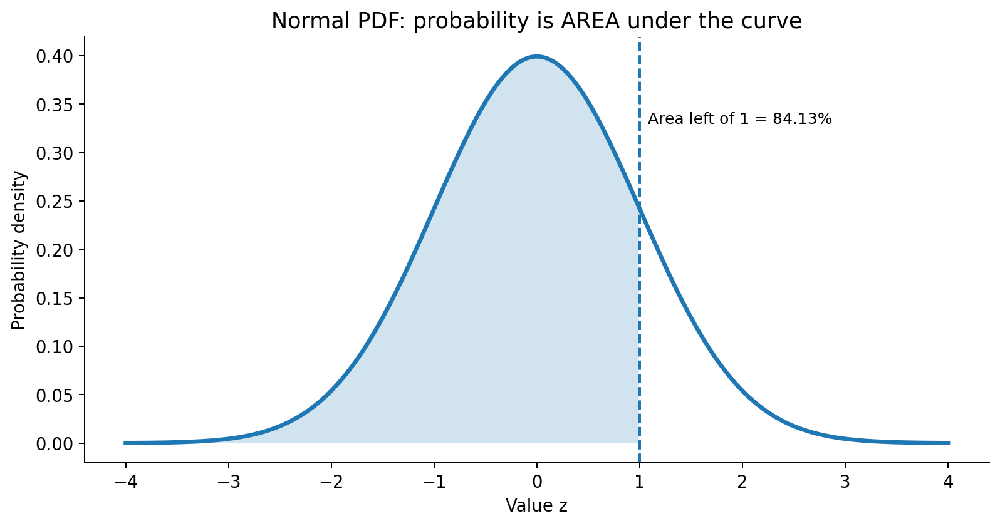

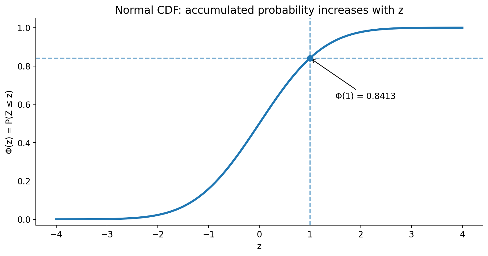

**Look at both figures together:** the shaded **area** in the PDF becomes the **height** of the CDF at the same input.


- **PDF (bell-shaped curve):** tells us *density* around each $x$.
- **CDF (S-shaped increasing curve):** tells us the probability of being at or below $x$.

$$
F(x)=P(X\le x)=\int_{-\infty}^{x}p(t)\thinspace dt.
$$

For a standard normal $Z\sim\mathcal N(0,1)$, the CDF is called $\Phi(z)$.

| $z$ | $\Phi(z)=P(Z\le z)$ |
|---:|---:|
| $-2$ | $0.0228$ |
| $-1$ | $0.1587$ |
| $0$ | $0.5000$ |
| $1$ | $0.8413$ |
| $2$ | $0.9772$ |

So $\Phi(1)=0.8413$ means about **84.13%** of the area under the standard normal PDF lies to the **left** of 1.

The CDF is **strictly increasing** for a normal distribution: if $a>b$, then $\Phi(a)>\Phi(b)$. This fact becomes crucial for maximizing PI later.

### 1.3 Standard normal, transformations, and the small uniform-distribution sketch

A *standard* Gaussian has mean 0 and variance 1:

$$
Z\sim\mathcal N(0,1).
$$

We can scale and shift it to generate any univariate Gaussian:

$$
\boxed{X=\mu+\sigma Z\quad\Longrightarrow\quad X\sim\mathcal N(\mu,\sigma^2).}
$$

How do we generate the standard normal sample in the first place? One way is **inverse-CDF sampling**:

1. Generate $U\sim\mathcal U(0,1)$, a uniform random number from 0 to 1.
2. Calculate $Z=\Phi^{-1}(U)$.
3. Calculate $X=\mu+\sigma Z$.

Example: if $U=0.7$, then $Z\approx0.5244$. If $\mu=50$ and $\sigma=10$, then $X\approx55.24$.

The key connection is that the **uniform draw provides a cumulative probability**, the inverse CDF maps that probability to a standard Gaussian value, and scaling/shifting produces the desired Gaussian value.

### 1.4 Multivariate Gaussian: uncertainty about **several related numbers**

Suppose we jointly model two values (e.g., height and weight):

$$
\mathbf X=\begin{bmatrix}X_1\\X_2\end{bmatrix}
\sim \mathcal N(\boldsymbol\mu,\Sigma).
$$

Instead of one mean and one variance, we use:

- A **mean vector** $\boldsymbol\mu$.
- A **covariance matrix** $\Sigma$.

For two variables:

$$
\Sigma=\begin{bmatrix}
\operatorname{Var}(X_1)&\operatorname{Cov}(X_1,X_2)\\
\operatorname{Cov}(X_2,X_1)&\operatorname{Var}(X_2)
\end{bmatrix}.
$$

- **Diagonal entries:** variance of each variable with itself.
- **Off-diagonal entries:** covariance between *different* variables.

For instance, the covariance of a variable with itself is its variance:

$$
\operatorname{Cov}(X_1,X_1)=\operatorname{Var}(X_1).
$$

This is precisely why later, in GP regression, $k(x_*,x_*)$ represents the **prior variance** at the new point.

A univariate Gaussian is the special case of a multivariate Gaussian with just one component.

---

# Part II — Gaussian Processes

## 2. Why do we need a Gaussian Process?

In **ordinary linear regression**, we choose a model shape such as

$$
f(x)=wx+b
$$

and fit parameters $w,b$ to the data. Other methods can fit nonlinear models, but the basic idea is to fit a chosen parameterization.

A **Gaussian Process (GP)** takes a different, probabilistic view:

> Before seeing the data, many functions are possible. A GP specifies a probability distribution over those possible functions.

It is written

$$
\boxed{f(x)\sim GP\big(m(x),k(x,x')\big).}
$$

This means that for **any finite selection of input locations**, the corresponding vector of function values has a joint multivariate Gaussian distribution.

A GP is not automatically a unique curve. It defines a distribution of curves.

## 3. The two ingredients of a GP: mean and kernel

### 3.1 Mean function

$$
m(x)=\mathbb E[f(x)].
$$

This gives the expected function value at each $x$ *before conditioning on observations*.

Your lecture often assumes $m(x)=0$ for convenience. **That does not mean every function value is zero.** It means the average across the prior distribution of functions is zero at each input.

### 3.2 Covariance function / kernel

$$
k(x,x')=\operatorname{Cov}\big(f(x),f(x')\big).
$$

The kernel tells us how strongly **function values** at two inputs tend to move together. It is calculated using the **input locations** $x,x'$.

The slides used two closely related squared-exponential / RBF kernels:

$$
k(x,x')=e^{-\lVert x-x'\rVert^2}
$$

and

$$
k(x,x')=e^{-\tfrac12(x-x')^2}.
$$

They differ in their distance scaling. Both are instances of

$$
\boxed{k(x,x')=\sigma_f^2\exp\left(-\frac{\lVert x-x'\rVert^2}{2\ell^2}\right)}
$$

where:

- $\ell$ = **length scale**: how quickly correlation decreases with distance.
- $\sigma_f^2$ = **signal variance**: the prior variance of function values.

With $\sigma_f^2=1$:

- $x=x'$ ⇒ $k(x,x)=1$ (self-covariance = variance).
- Nearby inputs ⇒ large positive covariance.
- Faraway inputs ⇒ covariance tends toward 0.

**Important distinction:** Kernel similarity is *not* the observed function output. A value $k(x_i,x_j)=0.9$ does not mean $f(x_i)=0.9$; it describes the covariance under the GP prior.

## 4. From inputs to covariance matrix $K$

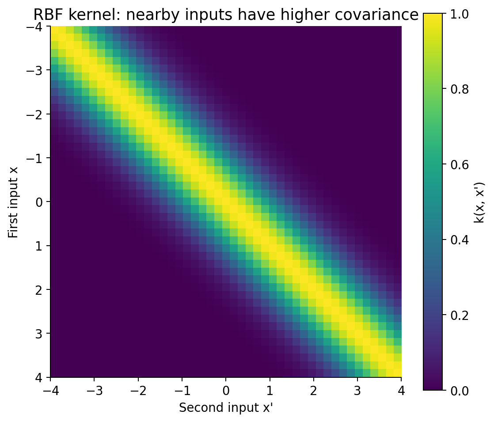

**Reading the heatmap:** the bright diagonal corresponds to $k(x,x)$ (self-covariance), while points farther apart typically have lower covariance with an RBF kernel.


Choose three input locations $X=[x_1,x_2,x_3]^T$. The corresponding function values are

$$
\mathbf f=\begin{bmatrix}f(x_1)\\f(x_2)\\f(x_3)\end{bmatrix}.
$$

Under a zero-mean GP prior,

$$
\mathbf f\sim\mathcal N(\mathbf0,K),
$$

where

$$
K=\begin{bmatrix}
k(x_1,x_1)&k(x_1,x_2)&k(x_1,x_3)\\
k(x_2,x_1)&k(x_2,x_2)&k(x_2,x_3)\\
k(x_3,x_1)&k(x_3,x_2)&k(x_3,x_3)
\end{bmatrix}.
$$

**What does $K$ do?** It specifies the variance and covariance of the *random function values*. It does **not yet give actual sampled values**.

For $N$ input points, $K$ has size $N\times N$.

### Critical confusion resolved: $k(x_*,x_*)$ versus $k(x_i,x_*)$

- $k(x_*,x_*)$ = covariance of $f(x_*)$ **with itself** = **prior variance at the query point**.
- $k(x_i,x_*)$ = covariance of $f(x_i)$ **with $f(x_*)$** = relationship between the training value and query value.

We use **both** when conditioning on training observations to predict at $x_*$. They perform different jobs.

## 5. What happens after creating $K$? Cholesky and sampling function curves

This section corresponds to the slide with **10 curves sampled from the GP prior**.

### Step 1: Decompose $K$

If $K$ is positive definite, compute its Cholesky factor:

$$
\boxed{K=LL^T.}
$$

$L$ is a lower-triangular matrix. Its purpose is to **introduce the correlations encoded in $K$**.

### Step 2: Generate independent Gaussian values

Generate a random vector

$$
\mathbf z\sim\mathcal N(\mathbf0,I).
$$

$I$ is the identity matrix, meaning each component of $\mathbf z$ has variance 1 and distinct components are independent.

### Step 3: Transform them

$$
\boxed{\mathbf f=L\mathbf z}\quad\text{(for a zero-mean GP)}.
$$

For a nonzero mean, use $\mathbf f=m(X)+L\mathbf z$.

Why does multiplying by $L$ work?

$$
\begin{aligned}
\operatorname{Cov}(\mathbf f)
&=\operatorname{Cov}(L\mathbf z)\\
&=L\operatorname{Cov}(\mathbf z)L^T\\
&=LIL^T\\
&=LL^T=K.
\end{aligned}
$$

The transformed values now have the covariance we intended.

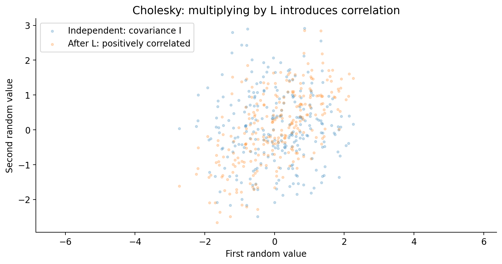

The scattered points above are *repeated random vectors*, not spatial function curves. They show the sole job of the Cholesky factor: transforming **independent** random values into values with the **chosen covariance**.

### Fully worked 2-point example

Let $x_1=1$ and $x_2=2$. Use $k(x,x')=e^{-\tfrac12(x-x')^2}$:

$$
K\approx\begin{bmatrix}1&0.607\\0.607&1\end{bmatrix}.
$$

One Cholesky factor is approximately

$$
L\approx\begin{bmatrix}1&0\\0.607&0.795\end{bmatrix}.
$$

Suppose the two independent random draws happen to be

$$
\mathbf z=\begin{bmatrix}0.5\\-1\end{bmatrix}.
$$

Then

$$
\mathbf f=L\mathbf z
=\begin{bmatrix}0.5\\0.607(0.5)+0.795(-1)\end{bmatrix}
\approx\begin{bmatrix}0.5\\-0.492\end{bmatrix}.
$$

This is **one random sampled function evaluated at two points**. Its values may differ, even though they are positively correlated *across repeated draws*.

### Step 4: Make the plot

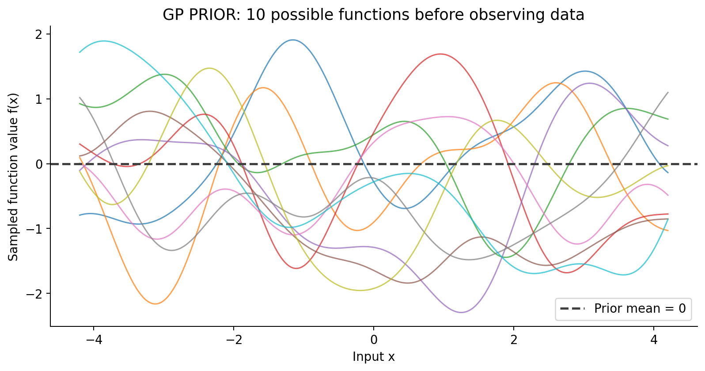

All ten curves use the **same kernel $K$**, but a new independent Gaussian vector $z$ is drawn for each curve. **No training data was used to select these functions.**


Choose, for example, 100 closely spaced inputs instead of two. Repeat the process with a $100\times100$ matrix. The result is 100 correlated function values; plot and connect them to approximate **one curve**.

Draw a fresh $\mathbf z$ and repeat: you get another curve. Repeat 10 times: you get the **10 prior curves** in the slide.

> **Do not confuse this with choosing a function after training.** Sampling 10 curves is an illustration of the *prior distribution*; they are not 10 fixed candidates that GP regression later chooses between.

> **Do not confuse the 100 input points with reducing the training dataset.** They are locations chosen to **visualize a sampled function**. This procedure is not dimensionality reduction or training-data selection.

**Numerical detail:** Cholesky needs a positive-definite matrix. Implementations often add a tiny diagonal *jitter* when the kernel matrix is nearly singular.

---

# Part III — GP regression: going from prior to posterior

## 6. What changes when we observe data?

Imagine we already evaluated an unknown function at three locations:

$$
D=\lbrace(x_1,y_1),(x_2,y_2),(x_3,y_3)\rbrace.
$$

We now want $f(x_*)$ at a new input $x_*$.

**Before using these observations:** the GP describes all functions plausible under the prior.

**After using these observations:** the GP describes functions plausible **given the observed data**. This updated distribution is the **posterior GP**.

For *noiseless* observations, the posterior functions are constrained to pass through all training points. For *noisy* observations, they do not have to pass exactly through the measured values.

### 6.1 The joint Gaussian

For a zero-mean GP, training function values $\mathbf f$ and the query value $f_*$ satisfy

$$
\begin{bmatrix}\mathbf f\\f_*\end{bmatrix}
\sim\mathcal N\left(
\begin{bmatrix}\mathbf0\\0\end{bmatrix},
\begin{bmatrix}K&\mathbf k_*\\\mathbf k_*^T&k_{**}\end{bmatrix}
\right).
$$

Here:

| Symbol | Meaning | Size for 3 training points, 1 query |
|---|---|---|
| $K$ | Covariances **between training points** | $3\times3$ |
| $\mathbf k_*$ | Covariances **between training and query** | $3\times1$ |
| $\mathbf k_*^T$ | Same cross-covariances, transposed | $1\times3$ |
| $k_{**}=k(x_*,x_*)$ | Query point's **prior variance** | $1\times1$ |

If you have multiple query locations, the bottom-right block becomes a full **query-to-query covariance matrix** $K_{**}$.

### 6.2 Conditioning: the central GP operation

**Conditioning** means using something we know to update the probability distribution of something we do not know.

Because the joint distribution is Gaussian, conditioning yields another Gaussian. In the zero-mean, **noiseless** case,

$$
\boxed{f_*\mid D\sim\mathcal N(\mu_*,\sigma_*^2)}
$$

with

$$
\boxed{\mu_*=\mathbf k_*^T K^{-1}\mathbf y}
$$

and

$$
\boxed{\sigma_*^2=k_{**}-\mathbf k_*^T K^{-1}\mathbf k_*.}
$$

For a general (nonzero) mean function $m(x)$, the mean becomes

$$
\boxed{\mu_*=m(x_*)+\mathbf k_*^TK^{-1}(\mathbf y-m(X)).}
$$

#### Understanding the mean equation in plain words

$$
\text{posterior mean}
=\text{prior mean}
+\text{correction learned from observed values}.
$$

- $\mathbf y-m(X)$: how much the observed outputs differ from prior expectations.
- $K^{-1}$: accounts for correlations among the observations (so their contributions are combined appropriately).
- $\mathbf k_*^T$: connects the query point to those observations.

#### Understanding the variance equation in plain words

$$
\text{posterior variance}
=\underbrace{k_{**}}_{\text{initial variance}}
-\underbrace{\mathbf k_*^TK^{-1}\mathbf k_*}_{\text{variance reduction from data}}.
$$

With a fixed kernel and fixed observation noise, **the query location and training input locations determine this variance**. The observed output magnitudes change the posterior mean, but not the posterior variance. If kernel hyperparameters are refitted after new observations, the story can be more complicated.

### 6.3 An easy numerical prediction using one observation

Take the zero-mean prior with kernel $k(x,x')=e^{-\tfrac12(x-x')^2}$.

We observe exactly one training point:

$$
(x_1,y_1)=(0,2).
$$

We want to predict at $x_*=1$.

- Training covariance: $K=[k(0,0)]=[1]$.
- Cross-covariance: $k_*=k(0,1)=e^{-1/2}\approx0.6065$.
- Query self-covariance: $k_{**}=k(1,1)=1$.

The noiseless GP equations give

$$
\mu_*=0.6065\times 2\approx\boxed{1.213}
$$

and

$$
\sigma_*^2=1-(0.6065)^2\approx\boxed{0.632},
\qquad \sigma_*\approx0.795.
$$

**Interpretation:** The GP's **point estimate** at $x=1$ is 1.213, but it is uncertain. The *actual* unknown function value need not equal 1.213.

If we query the observed input $x_*=0$ in this noiseless example, the predicted mean is 2 and the latent posterior variance is 0.

### 6.4 Variance versus standard deviation: which one is “uncertainty”?

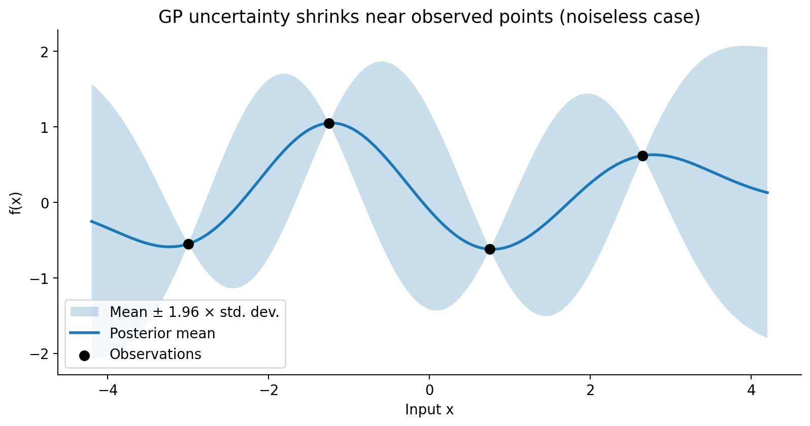

The shaded width is based on **standard deviation** ($\mu\pm1.96\sigma$), not on posterior variance directly.


Both describe uncertainty, but be precise:

- The GP conditional covariance equation gives **variance** $\sigma_*^2$.
- Taking its square root gives **standard deviation** $\sigma_*$.
- A commonly shown 95% posterior interval for a Gaussian latent value is $\mu_*\pm1.96\sigma_*$, **not** $\mu_*\pm1.96\sigma_*^2$.

For example, if $f_*\mid D\sim\mathcal N(5,0.25)$, then the point estimate is 5, the variance is 0.25, and the standard deviation is 0.5. The approximate 95% interval is $5\pm0.98=[4.02,5.98]$.

### 6.5 Noisy observations: the newer lecture slide

If measurements have independent Gaussian noise,

$$
y_i=f(x_i)+\varepsilon_i,\qquad\varepsilon_i\sim\mathcal N(0,\sigma_n^2),
$$

then we replace $K$ with $K+\sigma_n^2 I$ *when conditioning on the observations*:

$$
\boxed{\mu_*(x)=m(x)+\mathbf k_*^T(K+\sigma_n^2I)^{-1}(\mathbf y-m(X))}
$$

$$
\boxed{\sigma_{f,*}^2(x)=k(x,x)-\mathbf k_*^T(K+\sigma_n^2I)^{-1}\mathbf k_*}.
$$

That variance describes the **latent function** $f(x)$.

For a **new noisy measured output** $y_*$, the variance adds measurement noise:

$$
\boxed{\operatorname{Var}(y_*\mid D)=\sigma_{f,*}^2+\sigma_n^2.}
$$

This is why one slide shows a predictive variance of $\sigma_t^2(x)+\sigma_{\text{noise}}^2$.

### 6.6 **The crucial visual: prior → data → posterior → query point → mean and variance**

This is the precise sequence that caused the most confusion. **Read the figures from top to bottom.**

#### A. Start with the GP PRIOR (before any observations)


A GP **prior** defines a distribution over *possible functions*. The ten lines are ten *random examples*, **not** ten candidate models that will later be ranked and selected.

#### B. Add observations and obtain the GP POSTERIOR

We observe some input/output pairs $D=\lbrace(x_i,y_i)\rbrace$. Conditioning the prior on them produces a **posterior distribution over functions**:

$$
f\mid D \sim GP(m_{\mathrm{post}}, k_{\mathrm{post}}).
$$

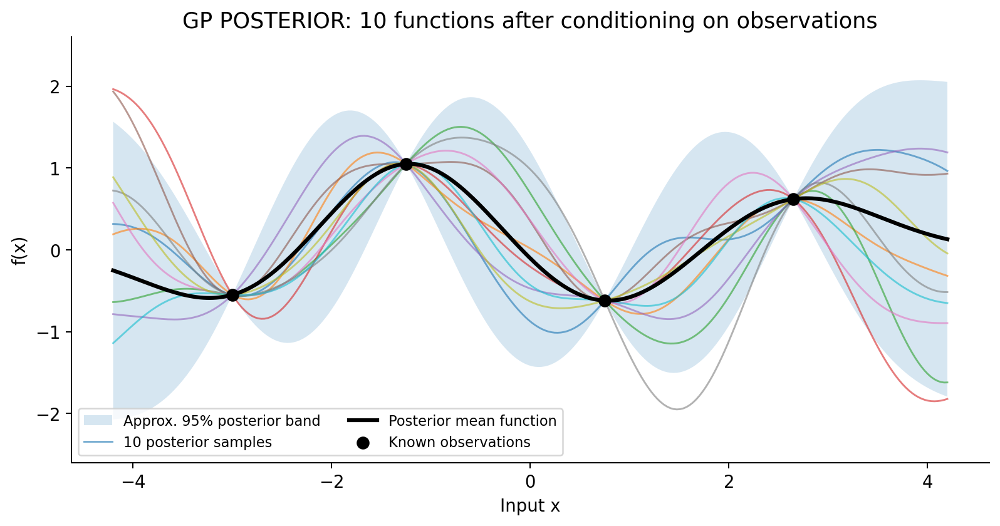

- **Dots** = observed data.
- **Thin curves** = ten *new samples from the posterior*, each a possible function after seeing the data.
- **Thick black line** = posterior **mean function** $m_{\mathrm{post}}(x)$.
- **Shaded region** = an approximate 95% pointwise posterior band based on $m_{\mathrm{post}}(x)\pm1.96\sigma_{\mathrm{post}}(x)$.

For *noiseless* observations, the posterior samples pass (up to numerical precision) through the observed points. These ten are visual illustrations only; **we do not choose one** as the answer.

#### C. A new input $x_*$ arrives: take a VERTICAL SLICE

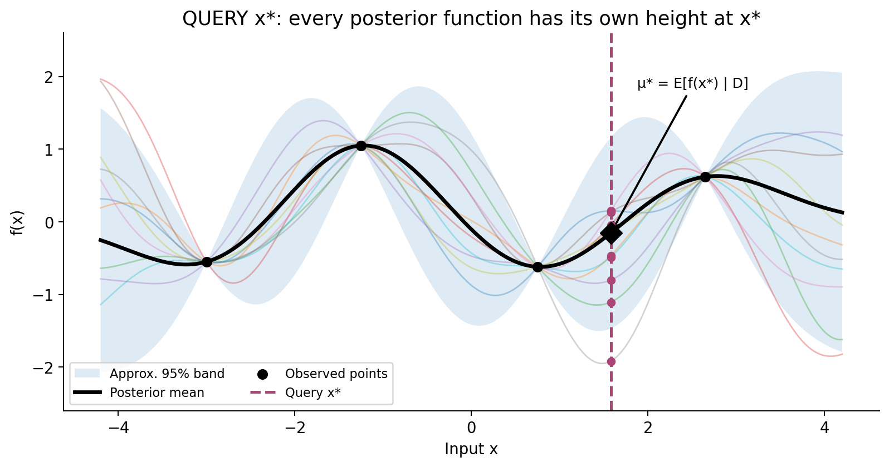

Imagine drawing a vertical line at $x_*$. Where it crosses each sampled function, you get **a possible output at the same input**. Ten curves give ten example output values:

$$
f^{(1)}(x_*),\ f^{(2)}(x_*),\ \ldots,\ f^{(10)}(x_*).
$$

Crucially, all those values are for the **same** $x_*$. The outputs differ because the GP posterior describes uncertainty about the unknown function, not because $x_*$ is changing.

#### D. Those possible heights form a GAUSSIAN distribution

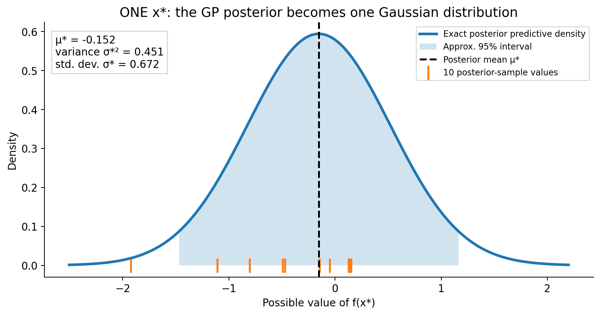

For one query location, the posterior implies

$$
\boxed{f(x_*)\mid D\sim\mathcal N(\mu_*,\sigma_*^2)}.
$$

Here are the three quantities you asked to connect:

1. **Mean $\mu_*$:** the center / expectation of the distribution of all possible posterior outputs at $x_*$. If you draw ten posterior functions and average their ten heights at $x_*$, you get a **rough estimate** of $\mu_*$. Averaging many more samples approaches the true posterior mean.
2. **Variance $\sigma_*^2$:** how strongly possible values differ from $\mu_*$ **on average, using squared deviations**. It's *not* the difference between the maximum and minimum sample heights.
3. **Standard deviation $\sigma_* = \sqrt{\sigma_*^2}$:** the spread measured in the same units as the function's output. Use $\mu_*\pm1.96\sigma_*$ to draw a pointwise approximate 95% posterior interval under Gaussian assumptions.

**Example of five possible posterior function heights** at the same $x_*$ (purely illustrative):

$$
4,\ 5,\ 5,\ 6,\ 5.
$$

Their sample average is $5$. The **population-form variance of these five equally weighted values** is

$$
\frac{(4-5)^2+(5-5)^2+(5-5)^2+(6-5)^2+(5-5)^2}{5}=\frac25=0.4.
$$

Their **range** is $6-4=2$. **Range $\ne$ variance.** These are just five illustrative heights, not an exact calculation of a GP posterior's analytic variance. If estimating an unknown variance from random samples, the usual unbiased sample-variance denominator is $n-1$; the GP's exact posterior variance comes from its conditional Gaussian formula.

#### E. How is the answer actually computed? No ten-curve sampling is needed!

For a zero-mean GP and noiseless observations, the **exact** posterior quantities at $x_*$ are

$$
\boxed{\mu_*=\mathbf k_*^T K^{-1}\mathbf y},
\qquad
\boxed{\sigma_*^2=k(x_*,x_*)-\mathbf k_*^T K^{-1}\mathbf k_*}.
$$

These formulas give the same mean and variance that the posterior function distribution describes; **they calculate them directly**, without drawing ten functions.

- **Point prediction:** $\hat f(x_*)=\mu_*$.
- **Uncertainty:** $\sigma_*^2$ (variance) or $\sigma_*$ (standard deviation).
- **Unknown actual value:** $f(x_*)$; it is **not guaranteed** to equal $\mu_*$.

If you evaluate $\mu_*(x)$ at many inputs, all those point predictions trace a **single posterior mean curve**. That mean curve is not a randomly selected prior sample or posterior sample.

> **Memory hook:** Prior = possible curves before data. Posterior = possible curves after data. Query $x_*$ = look at a vertical slice through those possibilities. Mean = central height; variance = spread of heights around that center. The final prediction uses the **analytic posterior mean**, not the tallest/lowest/sample curve.

#### F. What changes when noise is present?

With **noisy** observations, posterior sample curves need not pass exactly through measured dots. The formulas use $K+\sigma_n^2 I$ for conditioning. The latent-function prediction has variance $\sigma_{f,*}^2$; predicting a *new noisy measurement* additionally includes observation noise $\sigma_n^2$.

## 7. What, if anything, is learned in a GP?

Two related things happen:

1. **Posterior inference:** Observed data updates our distribution over possible functions. This happens even with a completely fixed kernel.
2. **Hyperparameter learning (often):** We tune parameters such as length scale $\ell$, signal variance $\sigma_f^2$, and noise variance $\sigma_n^2$, commonly by maximizing the marginal likelihood of the observed data.

If the slide fixes the kernel to $k(x,x')=e^{-\lVert x-x'\rVert^2}$ and leaves no tunable parameters, **posterior inference still works**; explicit kernel hyperparameter optimization is not required.

### GP versus linear regression

| Question | Simple linear regression | Gaussian Process regression |
|---|---|---|
| Typical model | $wx+b$ (or linear in selected features) | Distribution over functions, specified by mean/kernel |
| What is fitted? | Regression coefficients | Often kernel/noise hyperparameters; always conditions on data |
| Prediction | Usually a point estimate; uncertainty is also possible with a probabilistic model | Posterior mean **and** variance naturally available |
| Nonlinearity | Requires chosen nonlinear features/model | Depends on kernel (e.g., RBF permits smooth nonlinear curves) |
| Computation | Typically cheap at scale | Exact GP training commonly involves $O(N^3)$ matrix factorization |

**GPs also use linear algebra.** The difference is the probabilistic model, not “linear algebra versus GP.” A GP with a linear kernel is closely related to Bayesian linear regression.

---

# Part IV — Bayesian Optimization (BO)

## 8. Why GP prediction is useful for optimization

Consider an expensive machine experiment. You choose a temperature $x$ and the actual experiment returns a quality score $f(x)$.

You want

$$
\boxed{x_{\mathrm{optimal}}=\arg\max_x f(x).}
$$

But you **do not know the true function everywhere**. You can only discover $f(x)$ by evaluating selected inputs.

### The dashed line in the lecture figure

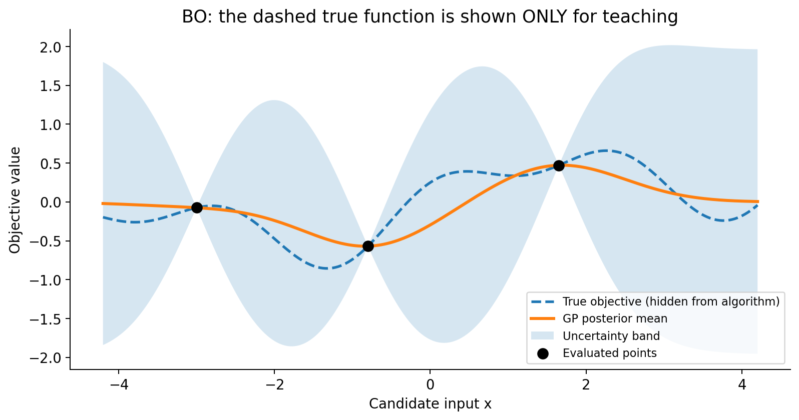

The dashed objective is only visible to us in this teaching plot; the optimizer **cannot** inspect that full curve.


- **Dashed curve:** the *true objective*, drawn so students can see what really happens. **The optimizer does not know it.**
- **Observed dots:** inputs already evaluated and their measured outputs.
- **Solid curve:** GP posterior mean, our current estimate.
- **Shaded band:** GP posterior uncertainty (often mean $\pm$ standard deviation).
- **Acquisition curve** (the green curve in the next figure): a score for how useful each possible next evaluation would be.

**This is not generally inverse prediction** (“here is the target output; find the input”). Standard BO tries to discover **which input achieves the largest unknown output**, often without knowing the maximum output value in advance.

## 9. Exploration versus exploitation

For the current dataset $D_t$, the GP gives, at any candidate $x$,

$$
f(x)\mid D_t\sim\mathcal N\big(\mu_t(x),\sigma_t^2(x)\big).
$$

- **Exploitation:** Test where the GP's predicted mean $\mu_t(x)$ is high; this looks promising now.
- **Exploration:** Test where the GP is uncertain ($\sigma_t(x)$ is high); it might reveal an unexpectedly good value.

Both matter because the highest *predicted* value may not be the true optimum.

### Is the mean not constant for a given input?

For a **fixed** GP posterior and **fixed** $x$, yes, $\mu_t(x)$ is a fixed number.

But while choosing the next experiment, **$x$ is not fixed yet**. We compare $\mu_t(x)$ at many possible inputs. The mean is a *function of $x$*.

With a zero-mean GP, for example,

$$
\mu_t(x)=\mathbf k(x)^T(K+\sigma_n^2I)^{-1}\mathbf y.
$$

Even though $K$, $\sigma_n^2$, and $\mathbf y$ are fixed for the current dataset, $\mathbf k(x)$ changes as the candidate location changes—so $\mu_t(x)$ changes too.

### Acquisition function: how to choose an input

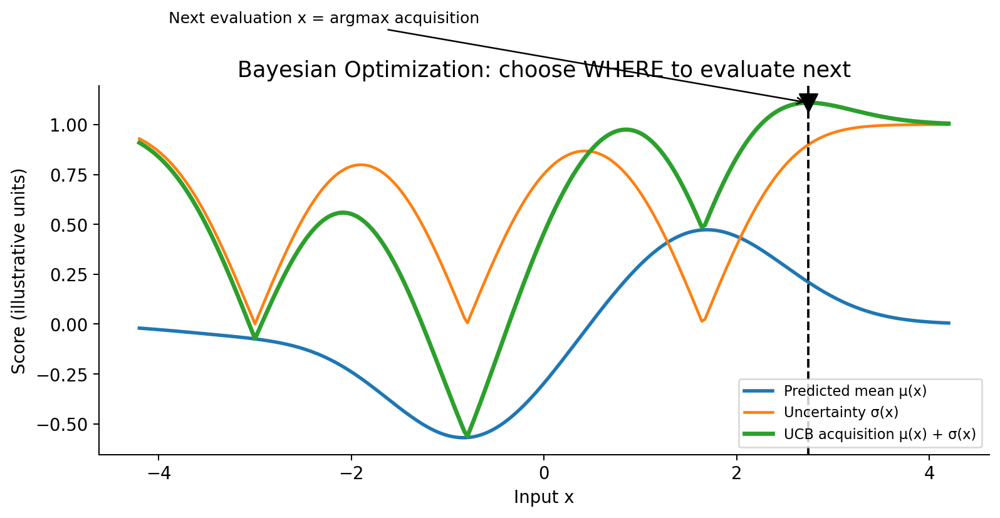

The arrow identifies **the input** with the highest acquisition score. The score is **not** an observed objective value; the real objective must be evaluated at that chosen input.


An **acquisition function** $a_t(x)$ assigns each possible new input a usefulness score. The algorithm chooses

$$
\boxed{x_{t+1}=\arg\max_x a_t(x).}
$$

**What do we do with the maximum score?** Usually nothing directly: we use the **input that achieves the highest score** as the next location to evaluate.

#### Example: Upper Confidence Bound (UCB)

For maximization, one acquisition function is

$$
a_t^{\mathrm{UCB}}(x)=\mu_t(x)+\beta\sigma_t(x),\qquad\beta\ge0.
$$

Example candidate scores with $\beta=1$:

| Candidate | Predicted mean | Std. deviation | UCB score |
|---|---:|---:|---:|
| A | 90 | 2 | 92 |
| B | 85 | 15 | **100** |
| C | 70 | 3 | 73 |

UCB chooses **B** for the next experiment. **100 is not the actual output at B**; it is a utility score.

### The BO loop in the $t=2$ and $t=3$ diagrams

1. At iteration $t=2$, two observations define the current GP posterior.
2. Compute the acquisition function across candidate inputs.
3. Choose $x_3=\arg\max_x a_2(x)$ (orange triangle).
4. Run the real experiment and observe $y_3=f(x_3)$ (or noisy $y_3$).
5. Add $(x_3,y_3)$ to the data.
6. Recompute the GP posterior: mean and uncertainty change, particularly around $x_3$.
7. Recompute the acquisition function and choose another location.

> We are **not** maximizing the acquisition score because we want that numerical score as the real-world result. The acquisition score is a **decision-making tool** for selecting where to spend the next costly evaluation.

---

# Part V — Probability of Improvement (PI)

## 10. PI from scratch: which candidate is likely to beat our best result?

Suppose we already tested several machine settings, and the **best measured score** is

$$
b=80.
$$

Now we must decide which setting to test next. **PI asks:**

> If we test candidate input $x$, what is the probability that its unknown function value beats our current best score?

The lecture denotes the best observed value by $\mu^+$ (some books use $f_{\mathrm{best}}$ or $y^+$). In this guide, write

$$
b=\mu^+=\max\lbrace y_1,\ldots,y_t\rbrace
$$

for the usual noiseless case.

We may also demand a small extra improvement $\xi\ge0$. The threshold is

$$
T=b+\xi.
$$

PI is the following probability:

$$
\boxed{PI_t(x)=P\big(f(x)\ge b+\xi\mid D_t\big).}
$$

For example, if $b=80$ and $\xi=2$, we're asking for the probability of reaching **at least 82** at the candidate input.

### 10.1 Use the GP posterior to compute that probability

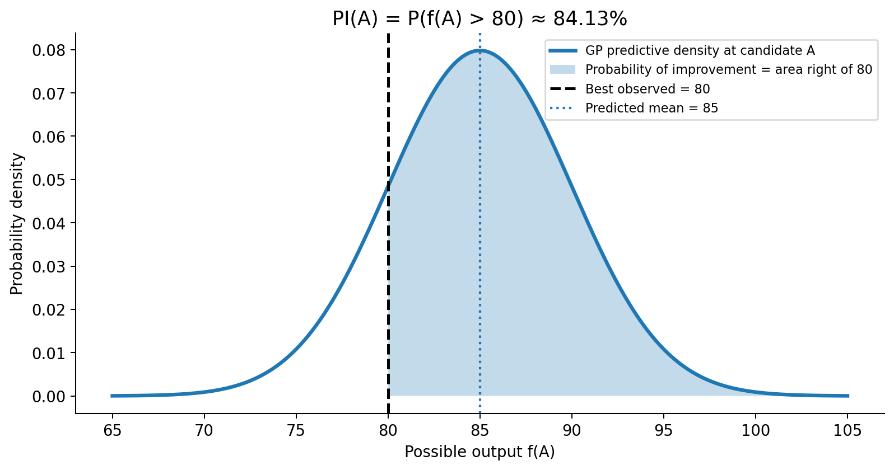

**PI is literally the area above the improvement threshold** under the predictive Gaussian at a candidate input.


At candidate $x$ the GP says

$$
f(x)\mid D_t\sim\mathcal N(\mu_t(x),\sigma_t^2(x)).
$$

So we have a normal distribution centered at $\mu_t(x)$, spread according to $\sigma_t(x)$.

**Geometric meaning:** Imagine a normal bell curve of *possible output values* at this candidate $x$. PI is the **area to the right of the threshold** $T=b+\xi$.

```text
Probability density at a particular candidate input x

                 bell-shaped predictive distribution
                            .-''-.
                         .-'      '-.
                       .'            '.
  --------------------+---------|-------+---------------- → possible output f(x)
                   mean μ      threshold T
                                <--- probability to the right of T = PI(x) --->
```

(Exact bell position changes depending on the candidate and whether the mean is above/below the threshold.)

### 10.2 Where does the formula with $\Phi$ come from?

We begin with

$$
PI_t(x)=P(f(x)\ge T).
$$

Standardize the predicted Gaussian using its **standard deviation**, not variance:

$$
Z=\frac{f(x)-\mu_t(x)}{\sigma_t(x)}\sim\mathcal N(0,1).
$$

Then, for $\sigma_t(x)>0$,

$$
\begin{aligned}
PI_t(x)
&=P\left(Z\ge\frac{T-\mu_t(x)}{\sigma_t(x)}\right)\\
&=1-\Phi\left(\frac{T-\mu_t(x)}{\sigma_t(x)}\right)\\
&=\Phi\left(\frac{\mu_t(x)-T}{\sigma_t(x)}\right).
\end{aligned}
$$

Substitute $T=b+\xi$:

$$
\boxed{PI_t(x)=\Phi\left(\frac{\mu_t(x)-b-\xi}{\sigma_t(x)}\right).}
$$

This is exactly the lecture formula.

### 10.3 What is the value inside $\Phi$?

Define the **standardized improvement score**:

$$
\boxed{z(x)=\frac{\mu_t(x)-b-\xi}{\sigma_t(x)}.}
$$

Interpretation:

> “How far is the predicted mean above (positive) or below (negative) the improvement threshold, measured in standard deviations?”

- $z=0$: the predicted mean is exactly at threshold, so PI is 50% if $\sigma>0$.
- $z=1$: the mean is one standard deviation **above** threshold; PI $\approx84.13\%$.
- $z=-1$: the mean is one standard deviation **below** threshold; PI $\approx15.87\%$.

### 10.4 Fully worked example with three candidates

Let $b=80$ and $\xi=0$, so the target is beating 80.

| Candidate | Predicted mean $\mu$ | Std. dev. $\sigma$ | $z=(\mu-80)/\sigma$ | $PI=\Phi(z)$ |
|---|---:|---:|---:|---:|
| A | 85 | 5 | $1$ | $84.13\%$ |
| B | 75 | 10 | $-0.5$ | $30.85\%$ |
| C | 90 | 5 | $2$ | **$97.72\%$** |

For candidate A:

$$
z(A)=\frac{85-80}{5}=1,\qquad PI(A)=\Phi(1)=0.8413.
$$

For B:

$$
z(B)=\frac{75-80}{10}=-0.5,\qquad PI(B)=\Phi(-0.5)=0.3085.
$$

For C:

$$
z(C)=\frac{90-80}{5}=2,\qquad PI(C)=\Phi(2)=0.9772.
$$

**PI chooses C as the next real-world experiment.** This does not guarantee C will be the true optimum; it is the *currently highest estimated probability* of surpassing the threshold.

### 10.5 How do mean and uncertainty affect PI?

The numerator contains the predicted mean relative to the threshold. The denominator contains the **standard deviation**.

This makes the role of uncertainty subtle:

- If $\mu<T$, **increasing $\sigma$** raises PI toward 50%: more uncertainty gives a greater chance to exceed a threshold that is above the predicted mean.
- If $\mu>T$, **increasing $\sigma$** lowers PI toward 50%: the mean is already above threshold, and more uncertainty introduces more chance of dropping below it.
- If $\mu=T$ and $\sigma>0$, PI is exactly 50% regardless of $\sigma$.

Therefore **PI does not simply reward bigger uncertainty**, unlike the added $+\beta\sigma$ term in UCB.

### 10.6 What happens if predictive standard deviation is zero?

The ratio $z=(\mu-T)/\sigma$ is undefined when $\sigma=0$.

In that degenerate case, the predictive output is deterministic under the model. Using the lecture's event $f(x)\ge T$:

- PI $=1$ if $\mu\ge T$.
- PI $=0$ if $\mu<T$.

Practical implementations handle this separately and may exclude previously evaluated points or use a strict-improvement convention. With nonzero observation noise, the latent posterior uncertainty at an observed point generally need not be exactly zero.

### 10.7 PI versus Expected Improvement (EI)

PI cares about **how likely** an improvement is, **not how large** it may be.

A candidate with a 90% chance of improving by 0.01 might outrank a candidate with a 50% chance of improving by 20. That is a limitation of PI.

**Expected Improvement (EI)** also considers the potential **magnitude** of improvement:

$$
EI(x)=\mathbb E[\max(f(x)-T,0)\mid D_t].
$$

For a Gaussian predictive distribution and $\sigma>0$,

$$
EI(x)=(\mu-T)\Phi(z)+\sigma\thinspace\phi(z),\qquad z=\frac{\mu-T}{\sigma},
$$

where $\phi$ is the standard normal **PDF**, while $\Phi$ is the **CDF**.

You do not need EI to understand the lecture's PI maximization, but it helps explain why practitioners may choose EI instead of PI.

---

# Part VI — The exact maximization question

## 11. Why can we maximize the expression **inside** the CDF instead of maximizing PI directly?

This is the key finding from the final discussion.

### 11.1 First: maximum versus argmax

Suppose

$$
g(1)=3,\qquad g(2)=5,\qquad g(3)=7.
$$

- $\max_x g(x)=7$: the **largest output**.
- $\arg\max_x g(x)=3$: the **input where that output occurs**.

**In Bayesian Optimization, we need the argmax:** the input to actually test next.

### 11.2 Second: what does strictly increasing mean?

A function $h(z)$ is strictly increasing if larger inputs always have larger outputs:

$$
a>b\quad\Rightarrow\quad h(a)>h(b).
$$

Example: $h(z)=z+10$.

- If $z_A=1$ and $z_B=2$, then $h(z_A)=11$ and $h(z_B)=12$.
- B remains larger both before and after applying $h$.

**An increasing transformation preserves the ranking of candidates.**

### 11.3 Third: the normal CDF is strictly increasing

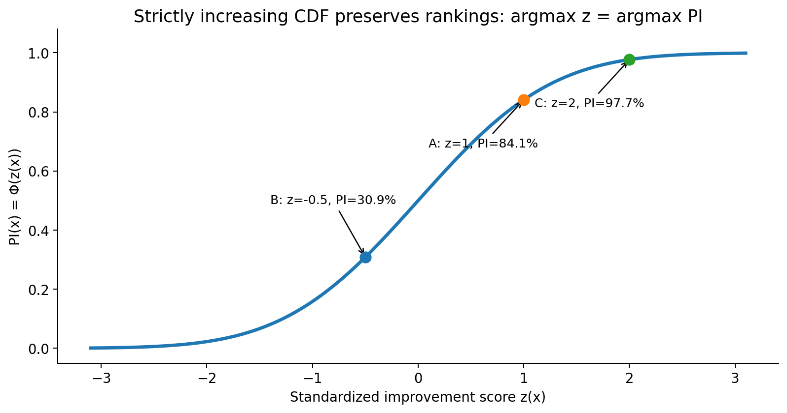

As you move right on the horizontal axis, the probability can **never go down**. Thus the candidate with the largest standardized score has the largest PI.


Look at familiar values:

| Input $z$ | CDF $\Phi(z)$ |
|---:|---:|
| $-1$ | $0.1587$ |
| $0$ | $0.5000$ |
| $1$ | $0.8413$ |
| $2$ | $0.9772$ |

Larger $z$ ⇒ larger $\Phi(z)$.

So if one candidate has $z_A=1$ and another has $z_B=2$,

$$
\Phi(z_A)=0.8413<0.9772=\Phi(z_B).
$$

**The CDF turns standardized scores into probabilities but never rearranges their order.**

### 11.4 Apply this to Probability of Improvement

Recall

$$
PI_t(x)=\Phi\underbrace{\left(\frac{\mu_t(x)-b-\xi}{\sigma_t(x)}\right)}_{z(x)}.
$$

The algorithm wants

$$
x_{t+1}=\arg\max_x PI_t(x).
$$

Because $\Phi$ is strictly increasing, whichever candidate maximizes $z(x)$ **also** maximizes $\Phi(z(x))$:

$$
\boxed{\arg\max_x\Phi(z(x))=\arg\max_x z(x).}
$$

Therefore, where $\sigma_t(x)>0$,

$$
\boxed{x_{t+1}=\arg\max_x\frac{\mu_t(x)-b-\xi}{\sigma_t(x)}.}
$$

**You can omit the CDF for the purpose of finding the best input.**

### 11.5 Example: same winning input, different numbers

Using the previous candidates:

| Candidate | $z(x)$ (inside CDF) | $PI(x)=\Phi(z(x))$ |
|---|---:|---:|
| A | 1 | 0.8413 |
| B | -0.5 | 0.3085 |
| C | **2** | **0.9772** |

- Maximizing the **inside value** gives C.
- Maximizing **PI** gives C.
- The selected **input** is identical.
- But the **maximum numerical value** differs: $2\ne0.9772$.

### 11.6 Three traps to avoid

**Trap 1: “So can I just maximize the mean?” — No.**

$$
\arg\max_x\mu_t(x)
$$

is generally **not** the same as

$$
\arg\max_x\frac{\mu_t(x)-b-\xi}{\sigma_t(x)}.
$$

The denominator can change the candidate ranking. We may remove the increasing *outer CDF*, **not** the standard deviation inside its argument.

**Trap 2: “Since the mean at $x$ is constant, how can we maximize it?”**

At one *fixed* $x$, $\mu_t(x)$ is fixed. But **before** choosing the next experiment, we are comparing **different candidate inputs**, each with a possibly different mean and standard deviation.

**Trap 3: “The best PI value is the actual output I will get.” — No.**

A PI value of 0.9772 is a **model-estimated probability (97.72%)** of beating the threshold. It is not the objective function output and not the amount of improvement.

### 11.7 The rule in general

For any **strictly increasing function** $h$ and candidate score $g(x)$,

$$
\boxed{\arg\max_x h(g(x))=\arg\max_x g(x),}
$$

provided the functions are defined on the candidates being compared.

For a **strictly decreasing** $h$, maximizing $h(g(x))$ instead corresponds to **minimizing** $g(x)$.

For a function that is merely *nondecreasing* with flat regions, ties can be introduced; exact argmax sets need not be identical. The standard normal CDF is **strictly** increasing, so the clean equivalence applies.

---

# Part VII — Putting it all together

## 12. A complete BO iteration, from raw observations to the next experiment

Assume you are maximizing product quality using temperature $x$.

1. **Start with real observed data:** $D_t=\lbrace(x_i,y_i)\rbrace_{i=1}^t$.
2. **Choose a GP mean/kernel** and optionally fit length scale, signal variance, and noise parameters.
3. **Condition the GP on data:** use covariance matrices to obtain its posterior.
4. **Consider any candidate temperature $x$:** evaluate the GP's $\mu_t(x)$ and $\sigma_t(x)$.
5. **Find the best observed score:** $b=\max_i y_i$ (in the simple noiseless setting).
6. **Compute PI:** $PI_t(x)=\Phi((\mu_t(x)-b-\xi)/\sigma_t(x))$.
7. **Choose the next input:** maximize PI, or equivalently maximize the standardized $z(x)$ where $\sigma_t(x)>0$.
8. **Run the actual experiment at the chosen input** and observe its real output.
9. **Append the new result**, update the GP posterior (and possibly refit hyperparameters), then repeat.

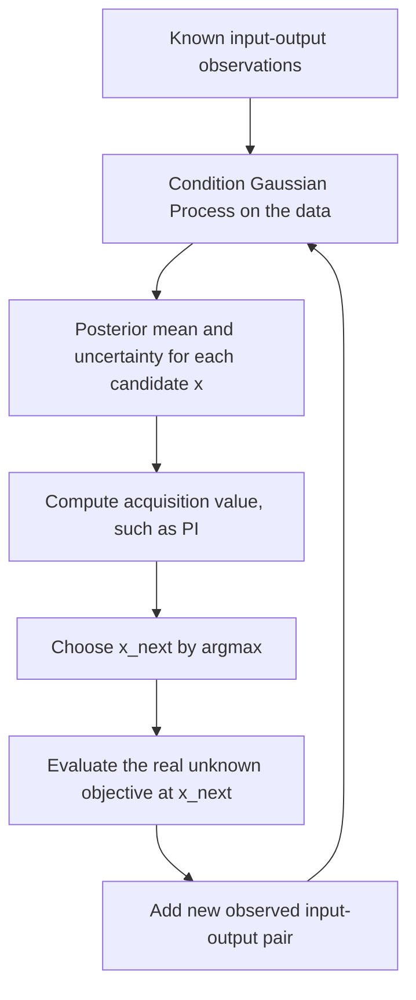

**End goal:** Find a very good (ideally globally optimal) input using **as few expensive evaluations of the true objective as possible**. BO does not require reconstructing every point of the hidden objective function.

---

